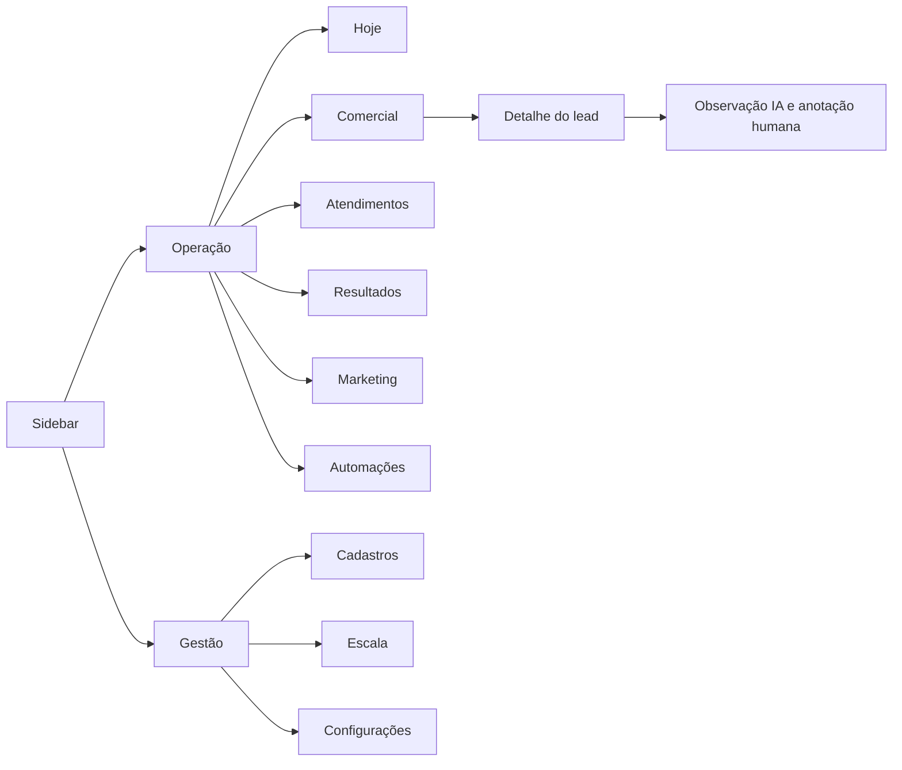

# Plano de refatoração de layout — todo o sistema DNZ

Data: 19/10/2026. Branch: `codex/melhorias-usabilidade`.
Estado em 19/10/2026: fundação visual, shell/rotas e a primeira tela Comercial foram implementados parcialmente nesta branch. A migração global do catálogo continua em andamento; nada foi publicado.

Referências internas: [diretrizes visuais](../DESIGN.md) e [evolução funcional](PLANO-EVOLUCAO-PLATAFORMA.md). Este plano detalha a interface e ajusta a organização das entregas anteriores, sem substituir os contratos dos cálculos, da Meta ou da API Winners.

## 1. Diagnóstico confirmado

| Evidência atual | Efeito no uso | Decisão |
| --- | --- | --- |
| `Header.tsx` e produção identificam todo o produto como Escala de Trabalho | Título não explica Leads, Metas e Automações | Marca Gerencia DNZ + título da rota |
| `TabNavigation.tsx` concentra módulos em uma faixa horizontal; `Index.tsx` controla a tela por estado | Navegação cresce em largura e não tem endereço por módulo | Sidebar, rotas e Breadcrumb |
| `Index.tsx` instancia hooks de vários módulos | Abrir a aplicação carrega dados que a pessoa não está usando | Consultas por rota e cache compartilhado |
| Filtros e tabelas são repetidos em Leads, Detalhado e Automações | Mesmo filtro muda de aparência e comportamento | FilterBar, filtros por domínio e DataTable comuns |
| Origem aparece em resumo clicável e na barra do Detalhado | Dois controles visuais para a mesma restrição | Um estado; clique no resumo ativa o filtro da barra |
| Há diferentes células de texto, combinação, Sim/Não e seleção | Edição fica inconsistente e pode perder significado de vazio | Controles por tipo e edição explícita |
| `App.tsx` monta Toaster e Sonner | Duas infraestruturas de feedback | Um adapter e um provider no destino |
| Tema atual é customizado, com Plus Jakarta Sans, Radix e Tailwind 3 | Preset não é obtido trocando uma cor | Migração de base, tokens, fonte e componentes |
| Indicadores, Metas e Acompanhamento exibem visões relacionadas em estruturas extensas | Decidir onde consultar e onde lançar demanda conhecimento prévio | Resultados com abas internas e simulador separado |
| Existem módulos manuais de anúncios e Taxa de Retorno SV | Contrariam a direção já definida para Meta | Remover da operação e criar Marketing |

A produção foi observada na tela Agenda; o inventário dos outros módulos foi realizado no código. O cadastro por IDs está em desenvolvimento local e deve ser reaproveitado. Não considerar a branch equivalente ao sistema publicado.

## 2. Preset e adoção integral do catálogo

O [preset b1sRltPJg](https://ui.shadcn.com/create?preset=b1sRltPJg) foi aberto e conferido: Vega, Neutral, Blue, Cyan, Inter para títulos/corpo, Lucide, raio Default, menu Default/Solid e destaque Subtle. A opção de base exibida é Base UI. Essas escolhas são obrigatórias na referência final.

“Todos os componentes” será atendido por uma biblioteca completa e uma galeria interna, com todos os itens do catálogo selecionado, seus estados e exemplos fictícios. Cada componente tem um destino abaixo; os de uso eventual ficam demonstrados na galeria até existir o fluxo correspondente. A galeria é uma ferramenta de manutenção, sem dados reais, fora da navegação diária e do bundle inicial.

Capturar o catálogo e a exportação na etapa L0, fixando versão do CLI/registry para tornar a entrega reproduzível. Componentes novos publicados depois entram em revisão futura. A [lista oficial](https://ui.shadcn.com/docs/components) diferencia componentes, receitas e outros pacotes; uma receita como Data Table exige composição, não apenas copiar um arquivo.

## 3. Navegação e destinos

| Área no menu | Rotas propostas | Conteúdo e objetivo |
| --- | --- | --- |
| Hoje | `/hoje` | Próximos contatos, atrasados, pendências de preenchimento e atalhos para trabalho |
| Comercial | `/comercial/leads`; detalhe `/comercial/leads/:id` | Lista única; visões Em atendimento, Perdidos e Pós-venda; abertura de detalhe por Sheet |
| Atendimentos | `/atendimentos`; detalhe `/atendimentos/:id` | Dados do Amigo e complementos operacionais atualmente em Detalhado |
| Resultados | `/resultados/visao-geral`, `/resultados/acompanhamento`, `/resultados/metas`, `/resultados/planejamento` | Indicadores, realizado, metas e simulador com funções identificadas |
| Marketing | `/marketing` | Desempenho Meta, conta/campanha/período e atualização da fonte |
| Automações | `/automacoes`; `/automacoes/:id` | Regras e execuções; Pendentes, Enviados e Relatório dentro de cada regra |
| Cadastros, grupo Gestão | `/cadastros/funcionarios`, `/cadastros/profissionais`, `/cadastros/categorias` | Identidades, situação e vocabulário compartilhado |
| Escala, grupo Gestão | `/escala` | Profissional por turno, calendário e mês/ano |
| Configurações, grupo Gestão | `/configuracoes/integracoes`, `/configuracoes/preferencias` | Amigo, UAZAPI, OpenAI, Meta, Winners e preferências disponíveis |
| Conta | `/auth`; recuperação de acesso quando suportada | Entrada e mensagens de sessão; menu do usuário com Sair |
| Galeria interna | `/ui` somente em desenvolvimento/homologação | Catálogo completo e cenários de interface |

Raiz `/` redireciona para Hoje quando o módulo estiver pronto. Enquanto isso, redireciona para Comercial. Links antigos conhecidos recebem destino compatível; o código atual usa uma única rota principal, portanto registrar novos links diretos a partir desta refatoração. Navegar para trás restaura filtros, página e posição da lista.



## 4. Unificações, exclusões e ajustes definidos

| Item | Tratamento | Condição para concluir |
| --- | --- | --- |
| Leads + Perdas | Uma área Comercial; Perdidos é visão filtrada e relatório contextual | Oportunidades abertas não aparecem como perdas; corrigir a regra em entrega de negócio identificada |
| Indicadores + Metas + Acompanhamento | Uma área Resultados, com filtros de período compartilhados quando o significado da data coincidir | Cada aba conserva sua fonte e base de cálculo explícitas |
| Simuladores dispersos | Concentrar em Resultados → Planejamento | Simulação não grava realizado nem altera meta até ação explícita |
| Detalhado | Renomear para Atendimentos | Preservar vínculo Amigo/complementos; não fundir clientes por nome |
| Anúncios DNZ, Anúncios SV, Taxa de Retorno SV | Retirar menu, telas e imports da aplicação ativa | Dados históricos preservados; Marketing mostra estado desconectado enquanto Meta não estiver pronta |
| Upload manual de métricas de anúncios | Retirar do fluxo ativo | Dados automáticos identificados por fonte; não preencher Meta com valores manuais sem rótulo |
| Análise WhatsApp | Sem aba dedicada; resumo no campo Observação com badge IA | Detalhe mostra data, estado e anotação humana separada |
| Cards de gênero inferido pelo nome | Retirar do fluxo principal de Leads | Não fazem parte da tarefa diária comercial; remover consulta automática associada após revisar consumidores |
| Nova Linha global | Substituir por ações da entidade | Novo lead, Cadastrar funcionário, Configurar meta; nenhum botão sem efeito |
| Atualizar global | Ação contextual de fonte/lista | Exibir atualização e falha no próprio módulo |
| Filtros de origem/canal equivalentes | Um controle e um estado por dimensão | Alias por domínio; canal comercial e origem de atendimento não são fundidos automaticamente |
| Toast legado + Sonner | Um provider final e adapter de transição | Notificação emitida uma vez, acessível e sem perda de erro |
| Células editáveis paralelas | Input/Combobox/Select/Date Picker compartilhados | Salvar/cancelar e comportamento de vazio consistentes |
| Cores dos dias, cards e badges locais | Tokens e variantes semânticas | Cor tem função e texto correspondente |
| `GenericTable`, `DetalhadoTable`, `StatsCard`, `ComboEditableCell` | Candidatos a remover após auditoria de imports | Busca atual não localizou consumidores externos às definições; confirmar imports dinâmicos antes de excluir |
| Funções e tabelas ligadas a telas retiradas | Inventariar consumidores e agendamentos separadamente | Remover interface não autoriza apagar históricos ou interromper integração ainda consumida |

## 5. Contrato visual por funcionalidade

| Tela | Estrutura final | Ação principal | Regra que precisa permanecer verificável |
| --- | --- | --- | --- |
| Hoje | Até quatro contadores + fila ordenada por prazo + lista de pendências | Abrir próximo contato | Cada contador abre exatamente seu conjunto; dados indisponíveis não viram zero |
| Comercial | Barra única + resumo curto + DataTable + detalhe lateral | Novo lead | Situação, responsável e próximo contato claros; seleção de pessoa por ID |
| Detalhe comercial | Identificação, contatos, situação, responsável, eventos e observações | Salvar alterações | Não fechar ao falhar; valor/data de venda dependem do contrato comercial |
| Perdidos | Visão do Comercial + distribuição de motivos | Registrar motivo/Reabrir quando suportado | Perda confirmada e sem data conhecida têm tratamento explícito |
| Atendimentos | Período/data de atendimento + profissional + origem + receita/visita/venda + lista | Complementar atendimento | Alterações do funcionário não sobrescrevem dados importados do Amigo |
| Resultados: visão geral | Quatro métricas + gráfico relevante + tabela de composição | Ver composição | Numerador, denominador, data e fonte expostos; agregados usam a mesma consulta |
| Acompanhamento | Calendário/grade de realizado, meta e pendências | Registrar fechamento enquanto necessário | Fechamento manual legado não soma em duplicidade com venda detalhada |
| Metas | Mês/ano, meta definida, evolução e parâmetros recolhíveis | Configurar meta | Sem divisão fixa por quatro; corrigir em entrega de cálculo, com comparação antes/depois |
| Planejamento | Parâmetros à esquerda e projeção à direita no desktop; empilhados no celular | Aplicar cenário à meta | Slider tem Input numérico equivalente e nunca modifica realizado |
| Marketing | Conta/período/campanha + métricas + tabela hierárquica + status de sincronização | Conectar conta ou atualizar dados | Fonte Meta, fuso, moeda e atribuição definidos; ROAS indisponível sem receita atribuída |
| Automações: lista | Regras em lista compacta com estado, público e última execução | Nova automação | Pausa/ativação apresenta alcance e resultado real |
| Automação: detalhe | Cabeçalho + Pendentes/Enviados/Relatório + configurações em Sheet | Editar automação | Status de envio e resposta separados; ações de envio nunca disparadas por navegação |
| Observação IA | Duas linhas de resumo na tabela, badge IA, detalhe com classificação/data | Ver análise | Nenhuma resposta autônoma; reprocessar análise não reenvia WhatsApp |
| Funcionários/profissionais | Lista com busca, função, situação e vínculos; formulário lateral | Cadastrar | Inativar preserva histórico; renomear precisa preservar IDs e associação de áudios |
| Categorias | Lista por domínio, rótulo, aliases e pendências | Cadastrar categoria | Não unir homônimos ou origens com significado diferente por semelhança |
| Escala | Mês/ano + grade de data/turnos/profissional + importação com prévia | Adicionar dia/Importar escala | Seleção por ID; confirmar importação antes de gravar; placeholders não contam como profissional |
| Integrações | Item/Card por serviço, última atualização, estado e ação contextual | Configurar integração disponível | Secrets não aparecem na UI; status vem do backend; Winners não parece disponível antes de publicar API |
| Autenticação | Card centrado, identidade DNZ, labels, erro e recuperação disponível | Entrar | Loading, sessão expirada e erro de conexão têm mensagem; nenhuma função de auth fictícia |
| 404/sem acesso | Empty com contexto e retorno seguro | Voltar à operação | Rota inexistente, acesso negado e fonte vazia são estados distintos |

## 6. Composições compartilhadas

| Composição DNZ | Peças shadcn | Contrato |
| --- | --- | --- |
| AppShell / AppSidebar / PageHeader | Sidebar, Sheet, Breadcrumb, Dropdown Menu | Navegação, título e conta comuns; conteúdo por rota |
| FilterBar / FilterChips | Combobox, Calendar, Popover, Badge, Button | Estado único; aplica o mesmo filtro a lista, resumo e exportação |
| EmployeeSelect / ProfessionalSelect / CategorySelect | Combobox | Busca por label; grava ID; inativos em histórico; estado de carregamento e erro |
| PeriodFilter | Date Picker, Calendar, Popover, Select | Início/fim e atalhos; rótulo da data de negócio |
| EntityTable / TableToolbar | Data Table, Table, Pagination, Checkbox, Dropdown Menu | Colunas por domínio e política clara de seleção/ordenação |
| EntityDetail / EntityForm | Sheet, Field, Input, Select, Textarea | Rascunho, validação, salvar/cancelar, proteção contra perda de edição |
| MetricCard / MetricDefinition | Card, Chart, Tooltip, Popover | Valor, unidade, base, período, origem e atualização |
| StatusBadge / SaveState / SourceState | Badge, Spinner, Alert | Vocabulário e cores iguais em todo módulo |
| AIObservation | Badge, Sheet, Item, Skeleton | Resumo da IA separado da anotação humana; estados completos |
| Confirmation / Feedback | Alert Dialog, Toast | Uma confirmação por ação necessária; um feedback por resultado |
| DataState | Skeleton, Empty, Alert, Button | Loading, primeira utilização, filtro vazio, erro e tentar novamente |

A [receita oficial de Data Table](https://ui.shadcn.com/docs/components/base/data-table) orienta a composição. Prever `@tanstack/react-table` como dependência a verificar/introduzir: o checkout tem React Query, mas não React Table. [Field](https://ui.shadcn.com/docs/components/base/field) define a base visual dos formulários; manter React Hook Form e Zod onde compatíveis, sem duplicar motores de validação.

## 7. Catálogo completo: destino de cada componente

Referência do inventário: [Components](https://ui.shadcn.com/docs/components), consultado em 19/10/2026. Cada item abaixo terá demonstração na galeria; a coluna indica o uso adicional previsto no produto. Exemplos sem funcionalidade correspondente usam dados fictícios e não criam requisitos de negócio.

| Componentes | Destino e diretriz |
| --- | --- |
| Accordion; Collapsible | Parâmetros avançados, ajuda e configuração extensa |
| Alert; Alert Dialog | Falha persistente de fonte; confirmação de exclusão/inativação quando houver consequência relevante |
| Aspect Ratio; Carousel | Prévia de imagens de importação/anexos; Carousel fica na galeria até haver múltiplas imagens úteis |
| Attachment | Detalhe de arquivos já disponíveis; respeitar acesso e disponibilidade reais |
| Avatar | Menu da conta e identificação de responsável, com iniciais como fallback |
| Badge; Marker | Estado, filtros e IA; Marker apenas para destacar trecho relevante com significado textual |
| Breadcrumb; Sidebar | Hierarquia de página e navegação principal |
| Bubble; Message; Message Scroller | Detalhe de mensagens futuras já capturadas, em leitura; sem campo de resposta ou histórico inventado |
| Button; Button Group | Ações contextuais e conjuntos relacionados, como período anterior/atual/próximo |
| Calendar; Date Picker | Períodos e datas de registro, atendimento e contato |
| Card; Item | Métricas e seções; filas, pessoas e integrações em listas |
| Chart | Evolução e comparação de resultados, com tabela equivalente |
| Checkbox | Seleção múltipla e operações em lote explicitamente disponíveis |
| Code Block | Exemplos fictícios de contrato Winners na área técnica; sem expor tokens |
| Combobox; Command | Seleção com busca; navegação rápida por módulos/ações permitidas |
| Context Menu | Atalho opcional de linha, sempre com alternativa no menu de ações |
| Data Table; Table | Grades operacionais e relatórios; composição única com colunas específicas |
| Dialog; Sheet; Drawer | Tarefa curta, detalhe completo e interação móvel, respectivamente |
| Direction | Configuração LTR coerente e demonstração de direção na galeria; interface DNZ em pt-BR |
| Dropdown Menu | Menu da conta, colunas, exportação e ações secundárias |
| Empty | Primeira utilização, sem resultados, fonte desconectada e indisponibilidade |
| Field; Label | Estrutura acessível de formulário e associação de campos |
| Hover Card; Tooltip | Prévia breve e ajuda; informação essencial também acessível por clique/foco |
| Input; Input Group | Busca, nomes, valores e telefone com prefixo/unidade quando necessário |
| Input OTP | Galeria; entrar no login só se existir fluxo real de código/MFA |
| Kbd | Indicação de atalhos realmente implementados |
| Menubar; Navigation Menu | Galeria e eventual navegação auxiliar de documentação; menu principal permanece Sidebar |
| Native Select; Select | Seleção curta; escolher um padrão por contexto e não duplicar a mesma escolha |
| Pagination | Lista paginada e quantidade por página com total da consulta |
| Popover | Calendário, filtro compacto e definição curta |
| Progress; Spinner | Importação mensurável e ação em andamento, respectivamente |
| Questionnaire | Galeria; eventual preenchimento guiado, quando o formulário realmente precisar de etapas |
| Radio Group | Escolha curta, explícita e exclusiva |
| Resizable | Lista/detalhe em desktops largos quando o ganho for confirmado; composição empilhada no celular |
| Scroll Area | Conteúdo lateral e lista limitada; evitar rolagens aninhadas desnecessárias |
| Separator | Divisão de grupos funcionais |
| Skeleton | Estados de carregamento que preservam o espaço do conteúdo |
| Slider | Cenários de planejamento, acompanhado de Input para valor exato |
| Switch | Preferências e estado binário com confirmação/feedback conforme consequência |
| Tabs | Visões internas de Resultados e Automações |
| Textarea | Observações humanas, justificativa detalhada e templates |
| Toast | Resultado transitório; provider único da biblioteca de destino |
| Toggle; Toggle Group | Densidade ou modo de apresentação, com estado acessível |
| Trace | Galeria e histórico técnico de etapas autorizadas; nunca expor raciocínio interno do modelo |
| Typography | Hierarquia e formatos textuais compartilhados |

O catálogo atual também mostra a coleção separada **AI Elements**. Se ela for incluída na exportação escolhida, sua cobertura completa será demonstrada na galeria: Chain of Thought, Chat, Checkpoint, Confirmation, Context, File Tree, Inline Citation, Message, Model Selector, Plan, Prompt Input, Queue, Reasoning, Sources, Stack Trace, Subagent, Suggestion, Task, Terminal, Test Results e Tool. Exemplos são sintéticos e só apresentam dados públicos de execução/resultados; componentes de raciocínio não exibem raciocínio privado. Não transformar essa coleção em um novo chat operacional: a decisão do produto continua sendo análise de conversas, sem resposta automática.

Form/useToast/Sonner e `synced-horizontal-scrollbar` já existentes entram no inventário de compatibilidade. A implementação do [Toast da base escolhida](https://ui.shadcn.com/docs/components/base/toast) será a referência final; remover o legado apenas depois de migrar seus consumidores.

## 8. Migração técnica e organização do código

Proposta de destino:

```text
src/components/ui/             primitivas do preset
src/components/app/            shell, sidebar e cabeçalho
src/components/data/           tabela, filtros e estados de dados
src/components/forms/          pessoas, categorias, datas e valores
src/features/comercial/        páginas, colunas, formulários e consultas
src/features/atendimentos/
src/features/resultados/
src/features/marketing/
src/features/automacoes/
src/features/cadastros/
src/features/escala/
src/features/configuracoes/
src/lib/formatters/             data, moeda, telefone e números
src/lib/metrics/                apresentação dos contratos de métricas
```

Procedimento:

1. Registrar inventário de arquivos, alterações locais existentes, imports e variantes; separar o trabalho já iniciado em cadastros do que é novo neste plano.
2. Gerar uma referência isolada Vite/Base UI com o preset e registrar `components.json`, tokens, fontes, versões e lista de componentes. O scaffold serve de referência, não substitui o repositório.
3. Migrar Tailwind/configuração e revisar o conjunto necessário de dependências. Tratar React Router/Vite como atualizações de compatibilidade separadas quando exigidas; não inferir versão só por sugestão automática de auditoria.
4. Adaptar a base Radix → Base UI: composição de triggers, `asChild`/renderização, refs, eventos, estados controlados, portals, data attributes, foco e estilos. Não presumir equivalência de props.
5. Introduzir adapters temporários para consumidores antigos; remover cada adapter quando não houver uso. Não colocar duas árvores de Dialog/foco envolvendo o mesmo fluxo.
6. Migrar shell e rotas, depois a tela piloto Comercial. Só propagar o padrão depois de validar o fluxo completo do piloto.
7. Migrar os demais módulos, retirar telas obsoletas e revisar imports/dependências ociosas. Remover CSS legado ao migrar seus consumidores.

A [CLI oficial](https://ui.shadcn.com/docs/cli) oferece `preset decode`, `apply` e `add --all`, além de prévia/diff para `add`. Na execução, decodificar o preset e comparar o resultado antes de sobrescrever arquivos. O comando exibido no gerador para projeto existente é `shadcn apply --preset b1sRltPJg`; ele não comprova por si só que o código Radix existente foi convertido. Fixar a versão utilizada e revisar o diff completo. A [instalação Vite](https://ui.shadcn.com/docs/installation/vite) é a referência para adaptar aliases e integração CSS.

**Andamento desta etapa:** tokens claros/escuros do preset, fonte Inter e `components.json` Vega/Neutral foram aplicados. O shell móvel usa Dialog do Base UI; o novo fluxo usa Button do Base UI. O restante das primitivas da aplicação ainda usa Radix e será migrado por etapas. A tabela Comercial já usa a receita com TanStack Table v9. A CLI `shadcn` foi tentada para confirmar o comando no projeto, mas o executável falhou ao carregar `@modelcontextprotocol/sdk`; os arquivos foram adaptados sem sobrescrever as primitivas antigas. `.npmrc` mantém a instalação reprodutível enquanto o app usa `date-fns` 3 com `react-day-picker` 8 e esta etapa usa somente Dialog/Button do Base UI.

## 9. Etapas de execução e aceite

| Etapa | Entrega revisável | Dependência | Critério de conclusão | Situação na branch |
| --- | --- | --- | --- | --- |
| L0 — Referência | Exportação do preset, inventário de telas/componentes e cenários fictícios | Acesso ao código e preset | Configuração exata documentada; lista completa sem item sem destino | Tokens/catalogação registrados; CLI não inicializou por dependência ausente |
| L1 — Fundação | Base UI, tokens, fonte, configuração CSS, adapters e galeria | L0 | Todos os componentes do catálogo demonstráveis; claro/escuro, foco e estados revisados; build/tipos passam | Parcial: tokens, Button/Dialog Base UI; galeria e migração das demais primitivas pendentes |
| L2 — Estrutura | Sidebar, rotas, PageHeader, conta e páginas de estado | L1 | Link direto, voltar/avançar, refresh e navegação móvel funcionam | Parcial: rotas novas para Comercial, Atendimentos, Escala, Cadastros, Resultados, Automações e Marketing; os detalhes de automação ainda usam estado local |
| L3 — Piloto Comercial | FilterBar, DataTable, cadastro por seleção e detalhe lateral | L2 + IDs/cadastros | Criar, editar, filtrar e reabrir sem perder estado; resumo/lista conciliam | Implementado localmente; precisa da migração IDs no ambiente e validação visual/autenticada |
| L4 — Operação | Atendimentos, Escala e Cadastros | L3 | Mesmos padrões; importação com prévia; inativos no histórico; mês/ano coerentes | Parcial local: rotas e cabeçalhos próprios, Cadastros separado por tipo, IDs na Escala, filtro por mês/ano e importação em duas fases com prévia editável. Tabelas ainda usam componentes legados; Categorias e validação visual/autenticada pendentes; migração de IDs ainda não aplicada no ambiente |
| L5 — Resultados | Visão geral, Acompanhamento, Metas e Planejamento | L3 + contratos de cálculo | Comparação antes/depois com base rotulada; correções de regra documentadas separadamente | Parcial local: quatro rotas internas; simulador separado e sem gravação do realizado. Cálculos legados foram preservados; auditoria das fórmulas, estado sem dados e período mês/ano ainda pendentes |
| L6 — Automações/IA | Lista de regras, execução, Observação IA e configurações | L3 | Pendentes/enviados preservados; feedback completo; nenhuma mensagem real em validações | Parcial local: rota nova preserva regras e abas Pendentes/Enviados/Relatório; coluna Observação + badge IA e funções OpenAI existentes. Falta rota direta do detalhe, estados de fonte/execução e revisão do fluxo de falha |
| L7 — Simplificação/Marketing | Retirada das três abas antigas, Marketing e Configurações | L2; dados Meta dependem da integração | Sem navegação órfã; estado de conexão honesto; históricos recuperáveis | Parcial local: telas manuais Anúncios DNZ, Anúncios SV e Taxa de Retorno removidas da navegação/rota legada; dados preservados. Marketing mostra Meta desconectada; API/permissões ainda não foram integradas |
| L8 — Consolidação | Remoção de adapters e código ocioso; regressão visual/funcional; prévia | L4–L7 | Critérios globais abaixo aprovados, deploy compatível com schema e roteiro de reversão | Não iniciado nesta etapa |

Primeiro corte para revisão: L0–L3, com Comercial completo. Segundo: L4–L6. Terceiro: L7–L8. Meta/Winners podem ter a apresentação pronta com estado indisponível enquanto os serviços são implementados; não declarar integração concluída por existir uma tela.

As migrações de IDs/cadastros precisam preceder o frontend que exige esses campos. Mudanças visuais não executam migrações automaticamente. Para publicar, conferir o schema do ambiente, criar uma prévia com dados sintéticos/ambiente apropriado, verificar as rotas e então promover a entrega. Não ligar uma prévia interativa a gravações de produção para validação.

## 10. Validação e critérios objetivos

- Navegação: todos os módulos têm rota; sair e voltar preserva estado; root/404/sessão expirada têm destino útil.
- Responsividade: 360, 390, 768, 1024, 1440 e 1920 px, além de zoom de 200%. Tabelas largas ficam em região própria; nenhuma barra global de filtros exige rolagem horizontal permanente.
- Acessibilidade: teclado, foco/restauração de foco, labels, leitura de erros, contraste e movimento reduzido. Dropdown/Sheet/Dialog funcionam com mouse e teclado.
- Dados: filtros múltiplos, inativos, não informado, data sem ano legado, paginação e seleção em lote. Conferir que totais não são calculados apenas da página atual.
- Edição: envio duplo, conexão lenta, erro do servidor, cancelamento, erro de validação e saída com rascunho. Nenhuma falha fecha o formulário nem apaga dados preenchidos.
- Cálculos: registrar valores de referência e comparar numeradores, denominadores e totais. Toda diferença provocada por correção funcional tem justificativa; refatoração visual isolada mantém resultados.
- Automações: abrir telas, alterar filtro e consultar IA não enviam mensagens. Simular resultados de envio e erro com dados fictícios.
- Componentes: todos os itens do catálogo têm exemplo e estados aplicáveis; item indisponível na versão fixada é registrado, sem declarar cobertura fictícia.
- Desempenho: comparar tamanho e carregamento com baseline; rotas/gráficos/galeria sob demanda. Abrir Comercial não inicia consultas de Marketing/Metas.
- Checagens por entrega: build, tipos, lint dos arquivos alterados e testes focados nos contratos modificados. Regressão visual dos componentes e fluxos de criar/editar/filtrar, sem executar ações reais de WhatsApp.

## 11. Resultado esperado para o funcionário

Ao entrar, a pessoa identifica as pendências e abre o cliente com contexto. Encontra o mesmo filtro e o mesmo comportamento de edição em toda a plataforma. Seleciona pessoas e categorias já cadastradas; consegue distinguir dado realizado, meta e simulação; lê o resumo da IA junto ao registro; e recebe confirmação visível de cada gravação. A navegação deixa de depender de uma faixa extensa de abas e de botões genéricos.

## 12. Estado desta entrega

Base visual aplicada localmente: tokens exatos exportados, Inter, shell com sidebar adaptativa e rotas diretas para Comercial, Atendimentos, Escala, Cadastros, Resultados, Automações e Marketing. Comercial tem filtros por texto/canal canônico/funcionário/orçamento/venda, visões Todos/Em atendimento/Perdidos/Pós-venda, contagens sobre o mesmo conjunto filtrado, paginação, estado vazio/carregamento e detalhe editável. O formulário de novo lead só fecha depois de confirmar a gravação. Atendimentos reaproveita os dados e complementos do Amigo; Cadastros permite criar e inativar funcionários e profissionais em listas separadas; Escala seleciona profissionais por ID e filtra por mês/ano. A importação da escala agora mostra uma prévia da leitura da IA e só substitui o mês depois da confirmação. Resultados ganhou Visão geral, Acompanhamento, Metas e Planejamento; as fórmulas atuais foram mantidas e o simulador funciona sem consulta ao Amigo na rota de Planejamento. Automações tem rota própria e preserva as abas de operação e a badge IA. Marketing informa que a integração Meta está desconectada, sem dados simulados. As três telas manuais antigas saíram da navegação; as tabelas históricas não foram apagadas.

Este é um corte local revisável, não o aceite global de L1-L7: a galeria completa ainda não existe, a maioria dos componentes operacionais ainda é Radix, Categorias não tem catálogo definido e o fluxo de pessoas depende da migração de IDs/cadastros que continua local. A Edge Function de importação foi alterada junto com a interface e precisa ser publicada antes de usar a prévia no ambiente remoto. A conexão da Meta ainda não existe; Metas ainda usa filtro mensal e seus cálculos precisam de auditoria antes de qualquer correção. `npm run build`, `npx tsc --noEmit -p tsconfig.app.json`, a análise sintática da função com esbuild e `git diff --check` passaram; este último só apontou avisos de conversão de fim de linha nos arquivos já editados. Nenhum dado foi apagado e a versão não foi publicada.
