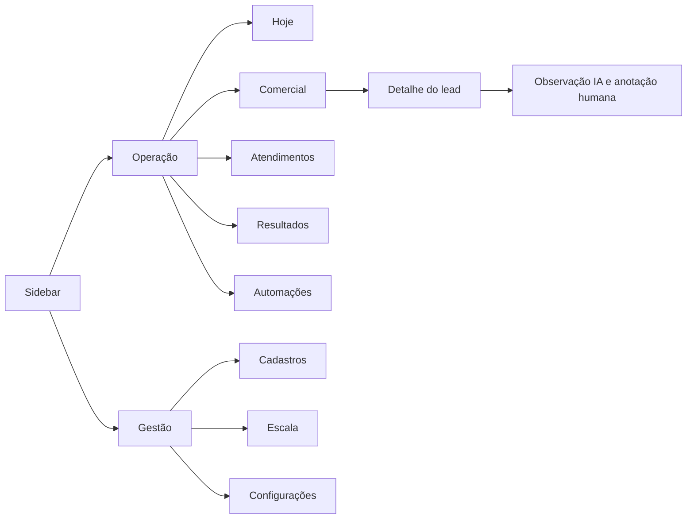

# Plano de refatoração de layout — todo o sistema DNZ

Data: 20/10/2026. Branch corrente: `codex/refatoracao-operacao`.
Registro no início da revisão de 20/10/2026: a branch partia do mesmo commit-base da `main` (`b835ae5`) e as alterações locais de L4–L8 ainda não estavam publicadas. O último deploy conhecido de `b835ae5` havia concluído. As migrações Supabase de IDs/cadastros, categorias e importação atômica estavam versionadas, mas ainda não haviam sido aplicadas ao banco nem acompanhadas da publicação das Edge Functions correspondentes.

Referências internas: [diretrizes visuais](../DESIGN.md) e [evolução funcional](PLANO-EVOLUCAO-PLATAFORMA.md). Este plano detalha a interface e ajusta a organização das entregas anteriores, sem substituir os contratos dos cálculos ou da API Winners. Marketing/Meta saiu do escopo em 20/10/2026.

## 1. Diagnóstico confirmado

| Evidência atual | Efeito no uso | Decisão |
| --- | --- | --- |
| `Header.tsx` e produção identificam todo o produto como Escala de Trabalho | Título não explica Leads, Metas e Automações | Marca Gerencia DNZ + título da rota |
| `TabNavigation.tsx` concentra módulos em uma faixa horizontal; `Index.tsx` controla a tela por estado | Navegação cresce em largura e não tem endereço por módulo | Sidebar, rotas e Breadcrumb |
| `Index.tsx` instancia hooks de vários módulos | Abrir a aplicação carrega dados que a pessoa não está usando | Consultas por rota e cache compartilhado |
| Filtros e tabelas são repetidos em Leads, Detalhado e Automações | Mesmo filtro muda de aparência e comportamento | FilterBar, filtros por domínio e DataTable comuns |
| Origem aparece em resumo clicável e na barra do Detalhado | Dois controles visuais para a mesma restrição | Um estado; clique no resumo ativa o filtro da barra |
| Há diferentes células de texto, combinação, Sim/Não e seleção | Edição fica inconsistente e pode perder significado de vazio | Controles por tipo e edição explícita |
| Baseline: `App.tsx` montava Toaster e Sonner | Dois sistemas podiam exibir feedback duplicado | Esta branch centraliza a fila em Base UI e usa um provider no shell |
| Tema atual é customizado, com Plus Jakarta Sans, Radix e Tailwind 3 | Preset não é obtido trocando uma cor | Migração de base, tokens, fonte e componentes |
| Indicadores, Metas e Acompanhamento exibem visões relacionadas em estruturas extensas | Decidir onde consultar e onde lançar demanda conhecimento prévio | Resultados com abas internas e simulador separado |
| Existiam módulos manuais de anúncios e Taxa de Retorno SV | A direção atual exclui essa área | Remover telas, navegação e código exclusivo; preservar registros históricos |

A produção foi observada na tela Agenda; o inventário dos outros módulos foi realizado no código. O cadastro por IDs está em desenvolvimento local e deve ser reaproveitado. Não considerar a branch equivalente ao sistema publicado.

## 2. Preset e adoção integral do catálogo

O [preset b1sRltPJg](https://ui.shadcn.com/create?preset=b1sRltPJg) foi aberto e conferido: Vega, Neutral, Blue, Cyan, Inter para títulos/corpo, Lucide, raio Default, menu Default/Solid e destaque Subtle. A opção de base exibida é Base UI. Essas escolhas são obrigatórias na referência final.

“Todos os componentes” será atendido por uma biblioteca completa e uma galeria interna, com todos os itens do catálogo selecionado, seus estados e exemplos fictícios. Cada componente tem um destino abaixo; os de uso eventual ficam demonstrados na galeria até existir o fluxo correspondente. A galeria é uma ferramenta de manutenção, sem dados reais, fora da navegação diária e do bundle inicial.

Capturar o catálogo e a exportação na etapa L0, fixando versão do CLI/registry para tornar a entrega reproduzível. Componentes novos publicados depois entram em revisão futura. A [lista oficial](https://ui.shadcn.com/docs/components) diferencia componentes, receitas e outros pacotes; uma receita como Data Table exige composição, não apenas copiar um arquivo.

## 3. Navegação e destinos

| Área no menu | Rotas propostas | Conteúdo e objetivo |
| --- | --- | --- |
| Hoje | `/hoje` | Próximos contatos, atrasados, pendências de preenchimento e atalhos para trabalho |
| Comercial | `/comercial/leads`; detalhe `/comercial/leads/:id` | Lista única; visões Em atendimento, Perdidos e Pós-venda; abertura de detalhe por Sheet |
| Atendimentos | `/atendimentos`; detalhe `/atendimentos/:id` | Dados do Amigo e complementos operacionais atualmente em Detalhado |
| Resultados | `/resultados/visao-geral`, `/resultados/acompanhamento`, `/resultados/metas`, `/resultados/planejamento` | Indicadores, realizado, metas e simulador com funções identificadas |
| Automações | `/automacoes`; `/automacoes/:id` | Regras e execuções; Pendentes, Enviados e Relatório dentro de cada regra |
| Cadastros, grupo Gestão | `/cadastros/funcionarios`, `/cadastros/profissionais`, `/cadastros/categorias` | Identidades, situação e vocabulário compartilhado |
| Escala, grupo Gestão | `/escala` | Profissional por turno, calendário e mês/ano |
| Configurações, grupo Gestão | `/configuracoes/integracoes`, `/configuracoes/preferencias` | Amigo, UAZAPI, OpenAI, Winners e preferências disponíveis |
| Conta | `/auth`; recuperação de acesso quando suportada | Entrada e mensagens de sessão; menu do usuário com Sair |
| Galeria interna | `/ui` somente em desenvolvimento ou homologação (`VITE_ENABLE_COMPONENT_GALLERY=true`) | Catálogo completo e cenários de interface |

Raiz `/` redireciona para Hoje, que agora é a tela inicial. Links antigos conhecidos recebem destino compatível; o código atual usa uma única rota principal, portanto registrar novos links diretos a partir desta refatoração. Navegar para trás restaura filtros, página e posição da lista.



## 4. Unificações, exclusões e ajustes definidos

| Item | Tratamento | Condição para concluir |
| --- | --- | --- |
| Leads + Perdas | Uma área Comercial; Perdidos é visão filtrada e relatório contextual | Oportunidades abertas não aparecem como perdas; corrigir a regra em entrega de negócio identificada |
| Indicadores + Metas + Acompanhamento | Uma área Resultados, com filtros de período compartilhados quando o significado da data coincidir | Cada aba conserva sua fonte e base de cálculo explícitas |
| Simuladores dispersos | Concentrar em Resultados → Planejamento | Simulação não grava realizado nem altera meta até ação explícita |
| Detalhado | Renomear para Atendimentos | Preservar vínculo Amigo/complementos; não fundir clientes por nome |
| Anúncios DNZ, Anúncios SV, Taxa de Retorno SV e Marketing | Retirar menu, telas e código exclusivo da aplicação ativa | Dados históricos preservados como legado; não haverá integração Meta |
| Upload manual e captura de métricas de anúncios | Remover do fluxo ativo | Código e funções exclusivas deixam de ser usados; históricos não são apagados |
| Análise WhatsApp | Sem aba dedicada; resumo no campo Observação com badge IA | Detalhe mostra data, estado e anotação humana separada |
| Cards de gênero inferido pelo nome | Retirar do fluxo principal de Leads | Não fazem parte da tarefa diária comercial; remover consulta automática associada após revisar consumidores |
| Nova Linha global | Substituir por ações da entidade | Novo lead, Cadastrar funcionário, Configurar meta; nenhum botão sem efeito |
| Atualizar global | Ação contextual de fonte/lista | Exibir atualização e falha no próprio módulo |
| Filtros de origem/canal equivalentes | Um controle e um estado por dimensão | Alias por domínio; canal comercial e origem de atendimento não são fundidos automaticamente |
| Toast legado + Sonner | Um provider final e adapter de transição | Notificação emitida uma vez, acessível e sem perda de erro |
| Células editáveis paralelas | Input/Combobox/Select/Date Picker compartilhados | Salvar/cancelar e comportamento de vazio consistentes |
| Cores dos dias, cards e badges locais | Tokens e variantes semânticas | Cor tem função e texto correspondente |
| `GenericTable`, `DetalhadoTable`, `StatsCard`, `ComboEditableCell` e os módulos da tela antiga | Removidos depois de auditar imports; hooks compartilhados permanecem quando usados por módulos atuais | Não há consumidor ativo; compatibilidade de `/modulos?tab=` mantida com redirecionamento |
| Funções e tabelas ligadas a telas retiradas | Inventariar consumidores e agendamentos separadamente | Remover interface não autoriza apagar históricos ou interromper integração ainda consumida |

## 5. Contrato visual por funcionalidade

| Tela | Estrutura final | Ação principal | Regra que precisa permanecer verificável |
| --- | --- | --- | --- |
| Hoje | Até quatro contadores + fila ordenada por prazo + lista de pendências | Abrir próximo contato | Cada contador abre exatamente seu conjunto; dados indisponíveis não viram zero |
| Comercial | Barra única + resumo curto + DataTable + detalhe lateral | Novo lead | Situação, responsável e próximo contato claros; seleção de pessoa por ID |
| Detalhe comercial | Identificação, contatos, situação, responsável, eventos e observações | Salvar alterações | Não fechar ao falhar; valor/data de venda dependem do contrato comercial |
| Perdidos | Visão do Comercial + distribuição de motivos | Registrar motivo/Reabrir quando suportado | Perda confirmada e sem data conhecida têm tratamento explícito |
| Atendimentos | Período/data de atendimento + profissional + origem + receita/visita/venda + lista | Complementar atendimento | Alterações do funcionário não sobrescrevem dados importados do Amigo |
| Resultados: visão geral | Quatro métricas + gráfico relevante + tabela de composição | Ver composição | Numerador, denominador, data e fonte expostos; agregados usam a mesma consulta |
| Acompanhamento | Calendário/grade de realizado, meta e pendências | Registrar fechamento enquanto necessário | Fechamento manual legado não soma em duplicidade com venda detalhada |
| Metas | Mês/ano, meta definida, evolução e parâmetros recolhíveis | Configurar meta | Sem divisão fixa por quatro; corrigir em entrega de cálculo, com comparação antes/depois |
| Planejamento | Parâmetros à esquerda e projeção à direita no desktop; empilhados no celular | Aplicar cenário à meta | Slider tem Input numérico equivalente e nunca modifica realizado |
| Automações: lista | Regras em lista compacta com estado, público e data do último envio concluído | Nova automação | Pausa/ativação apresenta alcance e resultado real |
| Automação: detalhe | Cabeçalho + Pendentes/Enviados/Relatório + configurações em Sheet | Editar automação | Status de envio e resposta separados; ações de envio nunca disparadas por navegação |
| Observação IA | Duas linhas de resumo na tabela, badge IA, detalhe com classificação/data | Ver análise | Nenhuma resposta autônoma; reprocessar análise não reenvia WhatsApp |
| Funcionários/profissionais | Lista com busca, função, situação e vínculos; formulário lateral | Cadastrar | Inativar preserva histórico; renomear precisa preservar IDs e associação de áudios |
| Categorias | Lista por domínio, rótulo, aliases e pendências | Cadastrar categoria | Não unir homônimos ou origens com significado diferente por semelhança |
| Escala | Mês/ano + grade de data/turnos/profissional + importação com prévia | Adicionar dia/Importar escala | Seleção por ID; confirmar importação antes de gravar; placeholders não contam como profissional |
| Integrações | Item/Card por serviço, última atualização, estado e ação contextual | Configurar integração disponível | Secrets não aparecem na UI; status vem do backend; Winners não parece disponível antes de publicar API |
| Autenticação | Card centrado, identidade DNZ, labels, erro e recuperação disponível | Entrar | Loading, sessão expirada e erro de conexão têm mensagem; nenhuma função de auth fictícia |
| 404/sem acesso | Empty com contexto e retorno seguro | Voltar à operação | Rota inexistente, acesso negado e fonte vazia são estados distintos |

## 6. Composições compartilhadas

| Composição DNZ | Peças shadcn | Contrato |
| --- | --- | --- |
| AppShell / AppSidebar / PageHeader | Sidebar, Sheet, Breadcrumb, Dropdown Menu | Navegação, título e conta comuns; conteúdo por rota |
| FilterBar / FilterChips | FilterPanel, FilterGrid, FilterField, SelectFilter, Combobox, Calendar, Popover, Badge, Button | Estado único; rótulos, espaçamento e breakpoints comuns em Comercial, Atendimentos e Cadastros; filtros equivalentes atualizam lista, resumo e exportação |
| EmployeeSelect / ProfessionalSelect / CategorySelect | Combobox | Busca por label; grava ID; inativos em histórico; estado de carregamento e erro |
| PeriodFilter | Date Picker, Calendar, Popover, Select | Início/fim e atalhos; rótulo da data de negócio |
| EntityTable / TableToolbar | Data Table, Table, Pagination, Checkbox, Dropdown Menu | Colunas por domínio e política clara de seleção/ordenação; a rolagem horizontal fica em uma única região nomeada e focável `TableScrollArea` |
| EntityDetail / EntityForm | Sheet, Field, Input, Select, Textarea | Rascunho, validação, salvar/cancelar, proteção contra perda de edição |
| MetricCard / MetricDefinition | Card, Chart, Tooltip, Popover | Valor, unidade, base, período, origem e atualização |
| StatusBadge / SaveState / SourceState | Badge, Spinner, Alert | Vocabulário e cores iguais em todo módulo |
| AIObservation | Badge, Sheet, Item, Skeleton | Resumo da IA separado da anotação humana; estados completos |
| Confirmation / Feedback | Alert Dialog, Toast | Uma confirmação por ação necessária; um feedback por resultado |
| DataState | Skeleton, Empty, Alert, Button | Loading, primeira utilização, filtro vazio, erro e tentar novamente |

A [receita oficial de Data Table](https://ui.shadcn.com/docs/components/base/data-table) orienta a composição. Prever `@tanstack/react-table` como dependência a verificar/introduzir: o checkout tem React Query, mas não React Table. [Field](https://ui.shadcn.com/docs/components/base/field) define a base visual dos formulários; manter React Hook Form e Zod onde compatíveis, sem duplicar motores de validação.

## 7. Catálogo completo: destino de cada componente

Referência do inventário: [Components](https://ui.shadcn.com/docs/components), consultado em 19/10/2026. Cada item abaixo terá demonstração na galeria; a coluna indica o uso adicional previsto no produto. Exemplos sem funcionalidade correspondente usam dados fictícios e não criam requisitos de negócio.

| Componentes | Destino e diretriz |
| --- | --- |
| Accordion; Collapsible | Parâmetros avançados, ajuda e configuração extensa |
| Alert; Alert Dialog | Falha persistente de fonte; confirmação de exclusão/inativação quando houver consequência relevante |
| Aspect Ratio; Carousel | Prévia de imagens de importação/anexos; Carousel fica na galeria até haver múltiplas imagens úteis |
| Attachment | Detalhe de arquivos já disponíveis; respeitar acesso e disponibilidade reais |
| Avatar | Menu da conta e identificação de responsável, com iniciais como fallback |
| Badge; Marker | Estado, filtros e IA; Marker apenas para destacar trecho relevante com significado textual |
| Breadcrumb; Sidebar | Hierarquia de página e navegação principal |
| Bubble; Message; Message Scroller | Detalhe de mensagens futuras já capturadas, em leitura; sem campo de resposta ou histórico inventado |
| Button; Button Group | Ações contextuais e conjuntos relacionados, como período anterior/atual/próximo |
| Calendar; Date Picker | Períodos e datas de registro, atendimento e contato |
| Card; Item | Métricas e seções; filas, pessoas e integrações em listas |
| Chart | Evolução e comparação de resultados, com tabela equivalente |
| Checkbox | Seleção múltipla e operações em lote explicitamente disponíveis |
| Code Block | Exemplos fictícios de contrato Winners na área técnica; sem expor tokens |
| Combobox; Command | Seleção com busca; navegação rápida por módulos/ações permitidas |
| Context Menu | Atalho opcional de linha, sempre com alternativa no menu de ações |
| Data Table; Table | Grades operacionais e relatórios; composição única com colunas específicas |
| Dialog; Sheet; Drawer | Tarefa curta, detalhe completo e interação móvel, respectivamente |
| Direction | Configuração LTR coerente e demonstração de direção na galeria; interface DNZ em pt-BR |
| Dropdown Menu | Menu da conta, colunas, exportação e ações secundárias |
| Empty | Primeira utilização, sem resultados, fonte desconectada e indisponibilidade |
| Field; Label | Estrutura acessível de formulário e associação de campos |
| Hover Card; Tooltip | Prévia breve e ajuda; informação essencial também acessível por clique/foco |
| Input; Input Group | Busca, nomes, valores e telefone com prefixo/unidade quando necessário |
| Input OTP | Galeria; entrar no login só se existir fluxo real de código/MFA |
| Kbd | Indicação de atalhos realmente implementados |
| Menubar; Navigation Menu | Galeria e eventual navegação auxiliar de documentação; menu principal permanece Sidebar |
| Native Select; Select | Seleção curta; escolher um padrão por contexto e não duplicar a mesma escolha |
| Pagination | Lista paginada e quantidade por página com total da consulta |
| Popover | Calendário, filtro compacto e definição curta |
| Progress; Spinner | Importação mensurável e ação em andamento, respectivamente |
| Questionnaire | Galeria; eventual preenchimento guiado, quando o formulário realmente precisar de etapas |
| Radio Group | Escolha curta, explícita e exclusiva |
| Resizable | Lista/detalhe em desktops largos quando o ganho for confirmado; composição empilhada no celular |
| Scroll Area | Conteúdo lateral e lista limitada; evitar rolagens aninhadas desnecessárias |
| Separator | Divisão de grupos funcionais |
| Skeleton | Estados de carregamento que preservam o espaço do conteúdo |
| Slider | Cenários de planejamento, acompanhado de Input para valor exato |
| Switch | Preferências e estado binário com confirmação/feedback conforme consequência |
| Tabs | Visões internas de Resultados e Automações |
| Textarea | Observações humanas, justificativa detalhada e templates |
| Toast | Resultado transitório; provider único da biblioteca de destino |
| Toggle; Toggle Group | Densidade ou modo de apresentação, com estado acessível |
| Trace | Galeria e histórico técnico de etapas autorizadas; nunca expor raciocínio interno do modelo |
| Typography | Hierarquia e formatos textuais compartilhados |

O catálogo atual também mostra a coleção separada **AI Elements**. Se ela for incluída na exportação escolhida, sua cobertura completa será demonstrada na galeria: Chain of Thought, Chat, Checkpoint, Confirmation, Context, File Tree, Inline Citation, Message, Model Selector, Plan, Prompt Input, Queue, Reasoning, Sources, Stack Trace, Subagent, Suggestion, Task, Terminal, Test Results e Tool. Exemplos são sintéticos e só apresentam dados públicos de execução/resultados; componentes de raciocínio não exibem raciocínio privado. Não transformar essa coleção em um novo chat operacional: a decisão do produto continua sendo análise de conversas, sem resposta automática.

Form/useToast e `synced-horizontal-scrollbar` já existentes entram no inventário de compatibilidade. O [Toast Base UI da referência shadcn](https://ui.shadcn.com/docs/components/base/toast) agora controla uma única fila no shell; os consumidores anteriores do hook e do Sonner usam o mesmo adapter e as dependências legadas foram removidas.

## 8. Migração técnica e organização do código

Proposta de destino:

```text
src/components/ui/             primitivas do preset
src/components/app/            shell, sidebar e cabeçalho
src/components/data/           tabela, filtros e estados de dados
src/components/forms/          pessoas, categorias, datas e valores
src/features/comercial/        páginas, colunas, formulários e consultas
src/features/atendimentos/
src/features/resultados/
src/features/automacoes/
src/features/cadastros/
src/features/escala/
src/features/configuracoes/
src/lib/formatters/             data, moeda, telefone e números
src/lib/metrics/                apresentação dos contratos de métricas
```

Procedimento:

1. Registrar inventário de arquivos, alterações locais existentes, imports e variantes; separar o trabalho já iniciado em cadastros do que é novo neste plano.
2. Gerar uma referência isolada Vite/Base UI com o preset e registrar `components.json`, tokens, fontes, versões e lista de componentes. O scaffold serve de referência, não substitui o repositório.
3. Migrar Tailwind/configuração e revisar o conjunto necessário de dependências. Tratar React Router/Vite como atualizações de compatibilidade separadas quando exigidas; não inferir versão só por sugestão automática de auditoria.
4. Adaptar a base Radix → Base UI: composição de triggers, `asChild`/renderização, refs, eventos, estados controlados, portals, data attributes, foco e estilos. Não presumir equivalência de props.
5. Introduzir adapters temporários para consumidores antigos; remover cada adapter quando não houver uso. Não colocar duas árvores de Dialog/foco envolvendo o mesmo fluxo.
6. Migrar shell e rotas, depois a tela piloto Comercial. Só propagar o padrão depois de validar o fluxo completo do piloto.
7. Migrar os demais módulos, retirar telas obsoletas e revisar imports/dependências ociosas. Remover CSS legado ao migrar seus consumidores.

A [CLI oficial](https://ui.shadcn.com/docs/cli) oferece `preset decode`, `apply` e `add --all`, além de prévia/diff para `add`. Na execução, decodificar o preset e comparar o resultado antes de sobrescrever arquivos. O comando exibido no gerador para projeto existente é `shadcn apply --preset b1sRltPJg`; ele não comprova por si só que o código Radix existente foi convertido. Fixar a versão utilizada e revisar o diff completo. A [instalação Vite](https://ui.shadcn.com/docs/installation/vite) é a referência para adaptar aliases e integração CSS.

**Andamento desta etapa:** tokens claros/escuros do preset, fonte Inter e `components.json` Vega/Neutral foram aplicados. O shell usa `Sidebar` no desktop e `Sheet` para o menu móvel. Button Base UI agora é a primitiva padrão exportada em components/ui/button; Label usa HTML semântico compartilhado, preservando `htmlFor`, classes e refs; os botões de calendário, confirmações e paginação compartilham suas variantes. A mudança migrou os consumidores existentes, e a propriedade asChild não tinha chamadas para Button. O Switch usa Base UI no controle de pausa global das automações. Checkbox migrou para Base UI na seleção de filtros da tabela de automações e está demonstrado na galeria. Collapsible migrou para Base UI no Acompanhamento Diário e ganhou exemplo interativo. Radio Group foi migrado para Base UI e demonstrado na escolha única da galeria. Os wrappers Dialog, AlertDialog, Sheet, Popover, Tabs, Select, Dropdown Menu, Radio Group e Tooltip agora usam Base UI; acionadores em automações, escala, registros detalhados, busca de comandos, filtros, calendários, seletores e painel móvel compartilham o padrão `render`, e a busca tem título acessível. Os estados de seleção e ocultação dos Tabs refletem os atributos Base UI. A galeria exercita os wrappers compartilhados em exemplos fictícios de diálogo, confirmação, painel lateral, filtro compacto, seleção, menu de ações, tooltip, painel expansível, escolha única e navegação por abas. As demais primitivas continuam em migração gradual. A tabela Comercial já usa a receita com TanStack Table v9. A CLI `shadcn` foi tentada para confirmar o comando no projeto, mas o executável falhou ao carregar `@modelcontextprotocol/sdk`; os arquivos foram adaptados sem sobrescrever as primitivas antigas. `.npmrc` mantém a instalação reprodutível enquanto o app usa `date-fns` 3 com `react-day-picker` 8 e esta etapa também migrou Checkbox, Collapsible, Dropdown Menu, Radio Group, Select e Tooltip para Base UI. Os adapters Radix de Toast, Separator, Progress, Slider, Toggle, Toggle Group, Accordion, Avatar, Scroll Area e Aspect Ratio foram removidos; nesta continuação, Context Menu, Menubar, Navigation Menu e Hover Card também migraram. O código-fonte não importa Radix e os dez pacotes Radix foram removidos das dependências diretas do projeto.

## 9. Etapas de execução e aceite

| Etapa | Entrega revisável | Dependência | Critério de conclusão | Situação na branch |
| --- | --- | --- | --- | --- |
| L0 — Referência | Exportação do preset, inventário de telas/componentes e cenários fictícios | Acesso ao código e preset | Configuração exata documentada; lista completa sem item sem destino | `components.json` agora segue o schema oficial (`base-vega`, Vega/Neutral, Lucide e menu Default/Subtle); dry-run do registry reconheceu os componentes e o conflito dos adapters locais, que foram preservados antes da adaptação |
| L1 — Fundação | Base UI, tokens, fonte, configuração CSS, adapters e galeria | L0 | Todos os componentes do catálogo demonstráveis; claro/escuro, foco e estados revisados; build/tipos passam | Em andamento nesta branch: galeria interna lazy em `/ui`, apenas em desenvolvimento ou homologação, com dados fictícios, busca, links para a referência oficial, status por componente e exemplos interativos de ações/feedback, campos, estados, tabela, Accordion, AlertDialog, Aspect Ratio, Attachment, Avatar, Breadcrumb, Bubble, Button Group, Calendar, Carousel, Chart sob demanda, Code Block, Combobox, Command, Date Picker, Dialog, Drawer, Field/Form, Input OTP, Pagination, Native Select, Resizable, Sheet, Popover, Scroll Area, Message, Message Scroller com viewport acessível e rolagem básica, Questionnaire em duas etapas (composição local), Direction LTR/RTL isolado, Typography/Typeset, Tabs, Select, Dropdown Menu, Checkbox, Empty, Input Group, Item, Kbd, Marker, Radio Group, Spinner, Toast, Separator, Progress, Slider, Toggle, Toggle Group, Trace e Tooltip. Calendário, paginação, seleção de período e formulário usam estado local; o Native Select altera o tamanho da página, o formulário mostra erro acessível e seu envio não persiste; Empty compõe os estados vazios comuns, Input Group apresenta unidades junto ao campo, Item organiza listas como Integrações, e Kbd/Marker têm exemplos visuais. PersonSelect usa agora Combobox Base UI com IDs dos cadastros; a galeria usa nomes fictícios. Bubble e Message compõem mensagens de leitura; Message Scroller oferece região focável com rolagem básica, sem ancoragem ou seguimento de streaming. Questionnaire tem uma prévia local de duas etapas com validação e navegação; a composição avançada de @shadcn/react fica pendente até haver fluxo real que a exija. Direction combina o provider Base UI com o atributo HTML dir, Typeset aplica hierarquia de conteúdo em uma área isolada, e Skeleton respeita a preferência por movimento reduzido. O catálogo diferencia essas composições semânticas de componentes ainda sem adapter. Catálogo lista 66 componentes e 21 AI Elements; Button, Switch, Checkbox, Accordion, Avatar, Dialog, AlertDialog, Sheet, Popover, Tabs, Select, Dropdown Menu, Radio Group, Toast, Separator, Progress, Slider, Toggle, Toggle Group, Scroll Area e Tooltip usam Base UI nos wrappers compartilhados e consumidores migrados; Label usa HTML semântico compartilhado; variantes de botão são compartilhadas por calendário, confirmações e paginação. Toast, login, atendimentos Amigo e avisos dos hooks compartilham agora o mesmo provider; Sonner e os adapters Radix de Toast, Separator, Progress, Slider, Toggle, Toggle Group, Accordion, Avatar, Scroll Area e Aspect Ratio foram removidos. Separator da navegação lateral usa Base UI e mantém orientação e estado decorativo; Progress, Slider e Toggle/Toggle Group têm exemplos controlados na galeria; Accordion, Avatar e Scroll Area usam Base UI, e Aspect Ratio usa CSS nativo. Context Menu, Menubar, Navigation Menu e Hover Card (Preview Card) migraram para Base UI e ganharam exemplos interativos fictícios na galeria; Breadcrumb, FormControl e os pontos asChild da sidebar usam useRender. Não há imports Radix no código-fonte e os dez pacotes Radix diretos foram retirados do manifesto. A auditoria responsiva das 16 rotas foi executada; a auditoria textual claro/escuro dos 17 estados de rota está registrada ao final. A revisão inicial de foco por teclado e overlays passou em Comercial, Atendimentos e Escala; navegação e breadcrumbs receberam o anel compartilhado. O percurso completo dos demais módulos, estados de erro/carregamento e adapters restantes segue em aberto. Os 21 padrões AI Elements têm exemplos sintéticos sob demanda |
| L2 — Estrutura | Sidebar, rotas, PageHeader, conta e páginas de estado | L1 | Link direto, voltar/avançar, refresh e navegação móvel funcionam | Em andamento nesta branch: `SidebarProvider`/`Sidebar` no desktop e `Sheet` no celular; menu, título, fechamento e retorno de foco verificados em 360 px, e seleção de rota fecha o painel. As rotas ativas, detalhe de lead/automação, Settings, redirecionamento legado e 404 já estão definidos; o shell preserva posição por entrada do histórico. A regressão de refresh/histórico foi repetida em Comercial (busca, detalhe, Voltar/Avançar e recarga; evidência ao final); a saída de sessão ainda precisa ser verificada após a troca do shell. |
| L3 — Piloto Comercial | FilterBar, DataTable, cadastro por seleção e detalhe lateral | L2 + IDs/cadastros | Criar, editar, filtrar e reabrir sem perder estado; resumo/lista conciliam | Incorporado à `main` (`b835ae5`); build e tipos passaram e o deploy da Vercel concluiu. Esta branch unifica também o estado vazio de Leads no DataState/Empty e permite limpar filtros por essa ação; os cartões de situação são os únicos controles desse filtro, sem repetição dentro do painel; a tela usa agora o PageHeader compartilhado, com ação de atualização identificada para leitores de tela em telas estreitas. No formulário de lead e no detalhe lateral, rótulos de data, selects e seletores de pessoas estão associados aos respectivos controles. Busca, canal, funcionário, orçamento, venda, situação e página agora são refletidos na URL; abrir/fechar o detalhe mantém esses critérios para restauração pelo histórico do navegador. O cadastro de lead mantém canais padrão disponíveis quando o catálogo falha, mantém a seleção disponível durante a nova tentativa e oferece atalho a Cadastros → Categorias sem atribuir a falha a uma causa ainda não confirmada. Navegação, filtro, estado vazio e busca do cadastro foram revisados localmente. A revisão responsiva de Novo Lead e detalhe foi conferida em 360 px sem overflow; permanece pendente aplicar a migração de IDs no Supabase. |
| L4 — Operação | Atendimentos, Escala e Cadastros | L3 | Mesmos padrões; importação com prévia; inativos no histórico; mês/ano coerentes | Em andamento nesta branch: filtro visual compartilhado, data e origem sem controles duplicados, tabelas Atendimentos/Escala usando `EntityDataTable`, seleção acessível de mês/ano, busca e situação de pessoas/categorias pelo mesmo CatalogFilters e estados explícitos de carregamento/erro/vazio, com ações acessíveis. Os filtros múltiplos de Atendimentos associam rótulos visíveis aos botões. O cadastro de funcionários/profissionais associa os campos aos rótulos, bloqueia envios repetidos e mostra andamento em criação e inativação; falhas de atualização da lista são diferenciadas do sucesso da gravação. O catálogo compartilhado de canais e origens agora tem tela em Cadastros, aliases explícitos, inativação reversível e seleção nas telas Comercial/Atendimentos sem reescrever valores históricos; o Comercial mantém opções de compatibilidade enquanto a migração versionada não for aplicada. A prévia da Escala associa cada turno a profissionais cadastrados, e a substituição mensal passa por RPC transacional. A exclusão de um dia na Escala agora pede confirmação identificando a data e o impacto nos dois turnos; vendedor/profissional usam seletores por ID e a auditoria não encontrou campos operacionais de cadastro livre de pessoas nesta etapa. Em Atendimentos, falha ao ler complementos locais fica visível, preserva dados previamente carregados e bloqueia edição até a nova consulta ter sucesso; a exclusão agora esclarece que remove apenas os complementos locais e preserva o atendimento de origem no Amigo. A amostra autenticada desta continuação confirmou quatro filtros nomeados em Atendimentos, abertura do popover de origem, fechamento por Escape e retorno do foco. A migração de IDs/categorias/importação, publicação coordenada da Edge Function e revisão visual completa seguem pendentes |
| L5 — Resultados | Visão geral, Acompanhamento, Metas e Planejamento | L3 + contratos de cálculo | Comparação antes/depois com base rotulada; correções de regra documentadas separadamente | Em andamento nesta branch: subrotas usam Tabs; seletores de período acessíveis, com Checkbox compartilhado no filtro multi-mês e garantia de ao menos um mês selecionado; campos do simulador e das metas usam Label com `htmlFor`; loading e erro visíveis nas fontes de Visão Geral, Acompanhamento e Metas, com nova tentativa. Em Metas, alternar o mês com rascunho oferece salvar, descartar ou continuar editando; falha de gravação mantém o estado não salvo e não perde os valores. A auditoria de fórmulas/fontes está registrada em `docs/AUDITORIA-CALCULOS.md`; fórmulas mantidas. Cenário numérico sintético e checagem semântica das agregações documentados; snapshot autenticado de referência e confirmação dos pontos de regra ainda pendentes |
| L6 — Automações/IA | Lista de regras, execução, Observação IA e configurações | L3 | Pendentes/enviados preservados; feedback completo; nenhuma mensagem real em validações | Em andamento nesta branch: detalhe abre por `/automacoes/:automationId`; lista e tabelas do detalhe usam `Table`; links, pesquisa, edição de observação e ações têm acesso por teclado/labels; busca e anotações usam Input compartilhado; Enter salva e Escape descarta nos editores em linha; observação mantém o rascunho aberto quando a gravação falha; remoção de áudio configurado tem nome acessível; falhas de fonte/histórico exibem erro e nova tentativa preservando dados carregados. No formulário de automações, falha ao criar/editar mantém a tela e os valores; gravação mostra estado de espera e impede fechar ou cancelar enquanto salva; falhas no envio e preparação de áudio aparecem ao usuário. Cancelar disparo agora informa erro de banco em vez de confirmar falsamente e bloqueia ações concorrentes do mesmo cliente. Pendentes, Enviados e Relatório compartilham os estados de carga/vazio; quando um filtro de resposta não encontra envios, a ação “Mostrar todos” permanece disponível. Lista revisada visualmente em 360–1920 px; detalhe em 360/768/1440 px; busca sem resultados e filtro de resposta Sim/Não validados; cancelamento por Escape do editor inline restaura o foco ao acionador; salvamento, falhas e fluxos de envio permanecem pendentes de revisão |
| L7 — Simplificação/Configurações | Retirada das telas de anúncios/retorno e ajustes de Configurações | L2 | Sem navegação órfã; históricos recuperáveis; integrações exibidas correspondem às suportadas | A tela de Marketing, links, função de extração de anúncios e função de retorno foram removidas do código local. Os registros e a migração histórica de anúncios no Supabase foram preservados. A remoção das funções ainda precisa ser confirmada no projeto remoto. Esta branch adiciona `/configuracoes/integracoes` e `/configuracoes/preferencias`, mapa de implementações sem expor secrets e preferência de tema claro/escuro/sistema salva no navegador. API Winners continua pendente |
| L8 — Consolidação | Remoção de adapters e código ocioso; regressão visual/funcional; prévia | L4–L7 | Critérios globais abaixo aprovados, deploy compatível com schema e roteiro de reversão | Em andamento nesta branch: removidos painel legado, AnunciosTable/useAnuncios e componentes sem consumidores após auditoria; tabelas históricas permanecem no Supabase. Estados de automações, resultados, metas e atendimentos agora usam variantes/tokens semânticos. A busca não encontra classes de paleta fixa em src; não há imports, dependências diretas ou referências Radix/accordion-down no código fora dos lockfiles; o chunk manual do Vite agora cobre apenas @tanstack. Build, checagem TypeScript do app e lint global passam; os 20 usos explícitos de `any` em quatro Edge Functions foram substituídos por tipos locais. A checagem Deno passou nas quatro funções. As 16 rotas foram verificadas em larguras de 360–1920 px sem overflow global; a auditoria textual de contraste em claro/escuro para 17 estados de rota está registrada ao final; a revisão inicial percorreu 30 paradas de teclado em Comercial, Atendimentos e Escala e validou um popover e um diálogo; o percurso completo dos outros módulos e sobreposições, estados de erro ainda não cobertos, fluxos de edição com falha de rede e a verificação de produção com as migrações aplicadas seguem pendentes. Os avisos Fast Refresh dos wrappers de UI foram resolvidos. |

Primeiro corte para revisão: L0–L3, com Comercial completo. Segundo: L4–L6. Terceiro: L7–L8. Meta/Winners podem ter a apresentação pronta com estado indisponível enquanto os serviços são implementados; não declarar integração concluída por existir uma tela.

Em Atendimentos, o filtro de profissional usa os nomes vindos do Amigo (`doctor.name`, com `user.name` como fallback) e inclui “Sem profissional” quando a origem não atribui um nome. A seleção filtra a lista e todas as métricas, sem alterar fórmulas; consultas e receitas totais continuam desconsiderando somente a origem do contato. A auditoria de cálculos agora distingue o filtro mês/ano da tela Escala da apuração mensal ainda usada por Metas. Na Escala, a geração pelo padrão associa os turnos a profissionais ativos por ID; nomes ausentes/inativos ou duplicados bloqueiam a gravação com orientação para corrigir o cadastro. Falhas de leitura do diretório ficam visíveis e permitem nova tentativa.

Em Metas/Acompanhamento, o mês selecionado agora mostra um aviso quando os registros disponíveis combinam anos diferentes ou não informam o ano; a fórmula permanece preservada enquanto a regra anual é validada.

Os cadastros de pessoas mantêm o nome associado aos vínculos históricos, pois leads e automações também consomem os campos textuais legados. A tela orienta inativar e criar um novo cadastro para substituir nome/cargo, sem reescrever histórico nem chaves de áudio.

A Visão geral de Resultados agora prioriza quatro indicadores, faturamento semanal em ordem cronológica e a tabela diária. As métricas complementares e suas bases ficam em uma seção recolhível, com numeradores, denominadores e fontes identificados. O simulador duplicado saiu dessa tela; Planejamento continua sendo seu destino.

As migrações de IDs/cadastros precisam preceder o frontend que exige esses campos. Mudanças visuais não executam migrações automaticamente. Para publicar, conferir o schema do ambiente, criar uma prévia com dados sintéticos/ambiente apropriado, verificar as rotas e então promover a entrega. Não ligar uma prévia interativa a gravações de produção para validação.

## 10. Validação e critérios objetivos

- Navegação: todos os módulos têm rota; sair e voltar preserva estado; root/404/sessão expirada têm destino útil.
- Responsividade: 360, 390, 768, 1024, 1440 e 1920 px, além de zoom de 200%. Tabelas largas ficam em região própria; nenhuma barra global de filtros exige rolagem horizontal permanente.
- Acessibilidade: teclado, foco/restauração de foco, labels, leitura de erros, contraste e movimento reduzido. Dropdown/Sheet/Dialog funcionam com mouse e teclado.
- Dados: filtros múltiplos, inativos, não informado, data sem ano legado, paginação e seleção em lote. Conferir que totais não são calculados apenas da página atual.
- Edição: envio duplo, conexão lenta, erro do servidor, cancelamento, erro de validação e saída com rascunho. Nenhuma falha fecha o formulário nem apaga dados preenchidos.
- Cálculos: registrar valores de referência e comparar numeradores, denominadores e totais. Toda diferença provocada por correção funcional tem justificativa; refatoração visual isolada mantém resultados.
- Automações: abrir telas, alterar filtro e consultar IA não enviam mensagens. Simular resultados de envio e erro com dados fictícios.
- Componentes: todos os itens do catálogo têm exemplo e estados aplicáveis; item indisponível na versão fixada é registrado, sem declarar cobertura fictícia.
- Desempenho: comparar tamanho e carregamento com baseline; rotas/gráficos/galeria sob demanda. Abrir Comercial não inicia consultas de áreas não utilizadas.
- Checagens por entrega: build, tipos, lint dos arquivos alterados e testes focados nos contratos modificados. Regressão visual dos componentes e fluxos de criar/editar/filtrar, sem executar ações reais de WhatsApp.

## 11. Resultado esperado para o funcionário

Ao entrar, a pessoa identifica as pendências e abre o cliente com contexto. Encontra o mesmo filtro e o mesmo comportamento de edição em toda a plataforma. Seleciona pessoas e categorias já cadastradas; consegue distinguir dado realizado, meta e simulação; lê o resumo da IA junto ao registro; e recebe confirmação visível de cada gravação. A navegação deixa de depender de uma faixa extensa de abas e de botões genéricos.

## 12. Estado desta entrega

Nesta continuação, a galeria recebeu exemplos locais de Attachment, Code Block, Trace e Input OTP, com conteúdo fictício e sem chamadas a serviços. Os componentes foram ajustados ao Tailwind 3 do projeto e usam `@/lib/utils`; a cópia do bloco de código tem fallback e feedback visível quando falha. Removi `cn`, `shiki` e os helpers de realce gerados porque a galeria usa texto simples e não precisa de realce de sintaxe.

Também unifiquei com o Button Base UI os controles de edição inline, opções do filtro múltiplo, cartões de situação e linhas móveis de leads, remoção de meses, exemplos de menu contextual e alternância de senha no login. O botão de senha agora tem rótulo e estado acessíveis e participa da navegação por teclado. Os campos nativos restantes nas telas operacionais são seletores de arquivo, mantidos para abrir os diálogos de arquivos do sistema.

O corte L0–L3 está incorporado à `main` em `b835ae5`; a Vercel marcou o deploy correspondente como concluído. Nesta branch `codex/refatoracao-operacao`, L1 ganhou a galeria interna lazy `/configuracoes/componentes`, acessível pela seção de Integrações e fora da navegação diária. Ela lista os 66 componentes e os 21 AI Elements da referência consultada, indica estado local de cada item, oferece busca e exemplos fictícios interativos para ações, feedback, campos, estados, tabela, Accordion, AlertDialog, Aspect Ratio, Attachment, Avatar, Breadcrumb, Bubble, Button Group, Calendar, Carousel, Chart sob demanda, Code Block, Combobox, Command, Date Picker, Dialog, Drawer, Field/Form, Input OTP, Pagination, Native Select, Resizable, Sheet, Popover, Scroll Area, Message, Message Scroller com viewport acessível e rolagem básica, Questionnaire em duas etapas (composição local), Direction LTR/RTL isolado, Typography/Typeset, Tabs, Select, Dropdown Menu, Checkbox, Empty, Input Group, Item, Kbd, Marker, Radio Group, Spinner, Toast, Separator, Progress, Slider, Toggle, Toggle Group, Trace e Tooltip. Calendário, paginação, seleção de período e formulário usam estado local; o Native Select altera o tamanho da página, o formulário mostra erro acessível e seu envio não persiste; Empty compõe os estados vazios comuns, Input Group apresenta unidades junto ao campo, Item organiza listas como Integrações, e Kbd/Marker têm exemplos visuais. PersonSelect usa agora Combobox Base UI com IDs dos cadastros; a galeria usa nomes fictícios. Bubble e Message compõem mensagens de leitura; Message Scroller oferece região focável com rolagem básica, sem ancoragem ou seguimento de streaming. Questionnaire tem uma prévia local de duas etapas com validação e navegação; a composição avançada de @shadcn/react fica pendente até haver fluxo real que a exija. Direction combina o provider Base UI com o atributo HTML dir, Typeset aplica hierarquia de conteúdo em uma área isolada, e Skeleton respeita a preferência por movimento reduzido. O catálogo diferencia essas composições semânticas de componentes ainda sem adapter. Catálogo lista 66 componentes e 21 AI Elements; Button, Switch, Checkbox, Accordion, Avatar, Dialog, AlertDialog, Sheet, Popover, Tabs, Select, Dropdown Menu, Radio Group, Toast, Separator, Progress, Slider, Toggle, Toggle Group, Scroll Area e Tooltip usam Base UI nos wrappers compartilhados e consumidores migrados; Label usa HTML semântico compartilhado; variantes de botão são compartilhadas por calendário, confirmações e paginação. Toast, login, atendimentos Amigo e avisos dos hooks compartilham agora o mesmo provider; Sonner e os adapters Radix de Toast, Separator, Progress, Slider, Toggle, Toggle Group, Accordion, Avatar, Scroll Area e Aspect Ratio foram removidos. Separator da navegação lateral usa Base UI e mantém orientação e estado decorativo; Progress, Slider e Toggle/Toggle Group têm exemplos controlados na galeria; Accordion, Avatar e Scroll Area usam Base UI, e Aspect Ratio usa CSS nativo. Context Menu, Menubar, Navigation Menu e Hover Card (Preview Card) migraram para Base UI e ganharam exemplos interativos fictícios na galeria; Breadcrumb, FormControl e os pontos asChild da sidebar usam useRender. Não há imports Radix no código-fonte e os dez pacotes Radix diretos foram retirados do manifesto. Revisão visual em navegador autenticado e migração das primitivas restantes continuam em aberto; os 21 padrões AI Elements têm exemplos sintéticos sob demanda

Ainda pendem em L4 a aplicação coordenada das migrações de IDs, categorias e RPC de importação, publicação da versão correspondente da Edge Function e revisão visual autenticada antes de usar a importação remotamente. Em L5 o cenário sintético de conferência já está documentado; pendem a captura de um snapshot numérico autenticado de referência e a confirmação da semântica dos pontos listados em `docs/AUDITORIA-CALCULOS.md`, antes de qualquer correção de regra. Em L6 pendem revisão visual autenticada e auditoria dos fluxos de edição/envio usando dados fictícios, sem disparar mensagens. Em L7 pendem consulta real de saúde das integrações, conexão da Meta e API Winners. L1-L3 e L8 conservam pendências descritas na tabela da etapa 9; a revisão visual autenticada de CSS e adapters segue aberta. Nesta continuação, a exclusão da Escala ganhou confirmação contextual com data e turnos afetados; vendedores e profissionais permanecem vinculados aos cadastros por ID. Os controles de remover áudio em Automações e de abrir WhatsApp em Atendimentos agora têm nomes acessíveis. Os complementos de Atendimentos mostram estado de carga/falha e bloqueiam escrita enquanto a consulta estiver indisponível, preservando dados previamente carregados e evitando criar duplicatas com uma leitura incompleta. Em Metas, trocar o mês com rascunho oferece salvar, descartar ou continuar; erro de gravação mantém os valores e o estado não salvo. A tela 404 agora usa os componentes compartilhados, explica o endereço em português e leva diretamente ao Comercial. Marketing agora indica “Integração pendente”, evitando afirmar desconexão sem uma checagem de saúde, e leva ao estado das integrações. `npx tsc --noEmit -p tsconfig.app.json`, ESLint focado nos arquivos atualizados e `npm run build` passaram sem erros nem avisos. ESLint focado nos formulários, editores, filtros, galeria e gráfico sob demanda passou sem erros ou avisos. Execuções anteriores do lint em exports compartilhados registraram quatro avisos de Fast Refresh. A build mais recente transformou 4.323 módulos; `vendor-runtime` ficou em 57,03 kB e `vendor-supabase` em 171,55 kB, sem alerta de tamanho. O `manualChunks` não força mais todo Base UI para o runtime comum: a galeria continua como import dinâmico em chunk de 319,93 kB. A aba AI Elements carrega sob demanda em chunk de 18,40 kB (5,30 kB gzip). O exemplo de Chart usa carregamento sob demanda: `GalleryChartDemo` gera chunk de 5,74 kB e `vendor-charts` 370,99 kB (102,75 kB gzip), carregados ao abrir a prévia. A galeria usa um inventário local estático para evitar chunks gerados apenas para listar arquivos. O `npm run lint` global passou após a substituição dos 20 usos explícitos de `any` em quatro Edge Functions por tipos locais; não aponta erros em `previewAuthStorage` nem em `amigo-api`. As exportações auxiliares que causavam avisos Fast Refresh foram removidas dos wrappers Badge, Form, Navigation Menu e Sidebar, sem consumidores externos. O ESLint focado nos arquivos alterados desta continuação passou sem erros ou avisos. A prévia local redireciona rotas protegidas para `/auth`; a inspeção autenticada dos módulos continua pendente. A tentativa de revisão visual desta rodada foi interrompida pelo Computer Use porque o navegador não forneceu uma URL confiável para identificar a janela. As alterações desta branch estão locais e não foram publicadas; nenhum dado foi apagado nem migração aplicada ao banco.

Nesta continuação, leads usa o PageHeader compartilhado e controles de pessoas, datas, selects e filtros de Atendimentos recebem rótulos associados. Automações agora preserva formulário e observação em falha de gravação, apresenta erros de áudio/cancelamento e bloqueia ações concorrentes do mesmo cliente. A galeria reconhece Attachment, Code Block e Trace como composições locais com exemplos, sem marcá-los como adapters pendentes.

Na revisão de responsividade, 16 rotas operacionais e de configuração foram conferidas em 360, 390, 590 (aproximação de zoom de 200%), 768, 1024, 1440 e 1920 px; após os ajustes, nenhuma delas apresenta overflow horizontal no documento, e cada uma mantém um H1 visível e título de página. O catálogo de componentes também foi conferido em 360/390 px. Para corrigir os pontos encontrados, Card e filhos do carrossel usam `min-w-0`, a paginação pode quebrar em várias linhas e os slots do OTP ficam compactos no celular; o formulário de Categorias muda de três para duas colunas em larguras médias. A navegação móvel foi aberta e fechada ao trocar de rota. Raiz, 404, links de navegação e histórico com filtro foram verificados; CTAs de navegação agora são links semânticos via `ButtonLink`, sem avisos Base UI e sem erro intencional no console da página 404.

Validação atual desta branch: `npx tsc --noEmit -p tsconfig.app.json`, `npm run build` (4.337 módulos) e `npm run lint` concluíram com sucesso; `npm ls --depth=0` não reportou dependências ausentes ou extraneous, e `git diff --check` passou após a atualização (com avisos de conversão LF/CRLF do Git). O preview local autenticado carrega em `/hoje`. A branch continua sem publicação; as migrações Supabase e o deploy coordenado da Edge Function seguem pendentes, e nenhuma gravação ou migração de produção foi feita durante esta revisão.

Em L2/L3/L4/L6/L8, os avisos de atualização em segundo plano de Hoje, Comercial, Atendimentos e da fila de Automações agora usam `DataState` na variante `refreshing`, com spinner e anúncio `role=status`/`aria-live` compartilhados. Em Comercial, a primeira carga não exibe contagens ou resumo como zero: os cartões mostram skeleton, o painel de filtros informa carregamento e, em falha inicial, as contagens ficam indisponíveis até nova tentativa. A revisão no preview local conferiu o skeleton durante a carga e os dados depois da resposta; nenhum formulário, mensagem ou registro foi alterado. TypeScript, build de produção (4.337 módulos) e lint global passaram.

Em L3/L8, os filtros do Comercial agora usam grade responsiva: um controle por linha no celular, dois por linha em tablet/desktop médio e cinco em desktop largo, com busca ocupando a primeira linha quando há duas colunas. A revisão visual em 360, 768, 1195 e 1440 px confirmou os respectivos layouts e `documentWidth === clientWidth`; a altura do painel caiu de 398 para 234 px em 1195 px e ficou em 70 px em 1440 px. A ordem dos filtros, os valores selecionados, a URL e os critérios de consulta foram preservados. TypeScript, build de produção (4.337 módulos) e lint global passaram; o preview voltou ao tamanho padrão e permanece aberto em Comercial.

Em L4/L8, os cartões móveis de Atendimentos agora têm largura mínima zero na grade e nos campos internos. Antes, os 300 cartões causavam 34 px de overflow no documento a 360 px; depois do ajuste, a largura do documento e do corpo ficou igual aos 345 px úteis do viewport e o primeiro/último cartão coube em 313 px. Os campos Sim/Não vazios mostram “Selecionar” nos cartões e “—” nas células compactas da tabela; a seleção grava os mesmos valores Sim/Não. O preview autenticado confirmou o ajuste em celular, e os filtros de busca temporários foram limpos sem editar registros. TypeScript, build de produção (4.337 módulos) e lint global passaram.

Em Metas, quatro indicadores principais abrem a leitura; composição, distribuição por período e fórmulas ficam recolhíveis. Os parâmetros do mês, incluindo vendas esperadas de Loja e Internet, também podem ser recolhidos e abrem ao editar. Cores locais foram substituídas por tokens semânticos; valores, fórmulas e gravação permanecem inalterados.

Em Acompanhamento, o consolidado agora agrupa meta e realizado em Vendas e Faturamento, com desvio junto a cada par. Tickets médios ficam recolhidos e os cabeçalhos da grade usam nomes completos; valores e cálculos não mudaram.

Em Cadastros, os filtros compartilhados de busca e situação agora têm rótulos visíveis associados aos controles. A busca de funcionários informa que encontra nome ou cargo.

Em Cadastros, o formulário de categorias agora impede envio duplicado, mantém os campos bloqueados durante a gravação e impede editar/inativar enquanto outra alteração está em curso; erros de atualização da lista não são apresentados como falha da gravação quando o banco já salvou.


Nesta continuação, ESLint global, TypeScript do app e build passaram após tipar as respostas externas e as filas de automação sem mudar seu comportamento. A checagem Deno passou nas quatro Edge Functions; a revisão visual autenticada dos módulos ainda falta. Em Automações, Pendentes, Enviados e Relatório agora usam os estados compartilhados de carga/vazio, e a tela oferece “Mostrar todos” quando uma resposta filtrada não tem correspondências.

Nesta continuação, a navegação lateral marca Comercial como ativa em toda a rota `/comercial`, incluindo a tela de detalhe; isso corrige a ausência de destaque visual do item.

O shell agora bloqueia logout duplicado, mostra andamento e informa sucesso ou erro na saída da conta.

No Comercial, removi a segunda cópia dos controles de situação: os cartões de resumo seguem selecionáveis e o FilterPanel mantém apenas busca e critérios complementares.

Em L4, Diretório de Pessoas e Categorias agora compartilham o componente CatalogFilters para busca e situação, com os textos singulares/plurais ajustados ao tipo de cadastro. Os dois filtros têm rótulos visíveis associados; a busca de funcionários indica que encontra nome ou cargo. Lint, TypeScript do app e build passaram após a extração. A Escala preserva os turnos já carregados quando uma atualização falha, exibe o aviso de erro e oferece nova tentativa; na carga inicial sem dados, continua apresentando o estado de erro completo. A importação da escala também pode ser acionada com teclado, e o arquivo selecionado pode ser escolhido novamente sem fechar o diálogo. Os seletores de profissionais identificam turno e data; a geração automática informa e bloqueia previamente nomes ausentes ou duplicados no cadastro.

Em L4, os formulários de funcionários, profissionais e categorias anunciam o andamento de gravação por uma região `role="status"`, além de mostrar o estado no botão. O retorno final de sucesso ou falha continua no toast compartilhado; nenhuma regra de cadastro foi alterada. ESLint focado, TypeScript do app, build e `git diff --check` passaram; a revisão autenticada dos módulos protegidos segue pendente.

Em L2–L3, filtros e paginação do Comercial e a fila selecionada em Hoje agora ficam na URL. Abrir um lead a partir de Hoje guarda o destino de retorno; o shell restaura a posição da rolagem ao voltar/avançar e mantém a posição ao abrir detalhes. ESLint focado, TypeScript do app, build e `git diff --check` passaram após a extensão de Atendimentos; a revisão visual autenticada das áreas protegidas ainda precisa ser feita com uma sessão de revisão apropriada.

Em L4, período do Amigo e filtros de Atendimentos agora ficam no state da entrada do histórico. Voltar para a tela restaura as seleções sem expor nomes de pacientes ou funcionários na URL; o período restaurado também volta a ser consultado no Amigo. ESLint focado, TypeScript do app, build (4.328 módulos) e `git diff --check` passaram. Revisão visual autenticada e migrações de produção seguem pendentes.

Em L4, a Escala também guarda mês/ano no state da entrada do histórico e restaura o período ao voltar à tela. Anos previamente selecionados continuam disponíveis no seletor mesmo quando não há registros carregados para eles. ESLint focado, TypeScript do app, build (4.328 módulos) e `git diff --check` passaram. A tentativa de inspeção visual desta rodada foi encerrada antes de interagir com a página porque Computer Use não identificou a URL do Chrome com confiança; a revisão autenticada continua pendente.

Em L4, busca e situação do Diretório de Pessoas e de cada catálogo de categorias, além da categoria ativa, agora são restauradas ao voltar à entrada do histórico. As consultas ficam no state do navegador, sem expor nomes na URL. ESLint focado, TypeScript do app e build (4.329 módulos) passaram.

Em L5, Metas restaura o mês selecionado e Indicadores restauram o ano e a seleção múltipla de meses ao voltar para a tela, guardando os filtros no state da entrada do histórico. Valores inválidos retornam ao período atual; fórmulas e fontes permanecem iguais. ESLint focado, TypeScript do app, build (4.328 módulos) e `git diff --check` passaram. A revisão visual autenticada permanece pendente.

Na auditoria de L5, uma comparação dos blocos de cálculo com `HEAD` confirmou que as fórmulas centrais de Metas, consolidação de Indicadores, consolidado do Acompanhamento e métricas por dia permanecem iguais à base. Em Acompanhamento, a única diferença dentro do consolidado é a remoção de dependências não lidas do `useMemo`. A confirmação das regras de negócio listadas em `AUDITORIA-CALCULOS.md` e a comparação com um snapshot autenticado seguem pendentes.

Em L2, o nome do cliente na fila de Hoje agora é um link de navegação para o lead, com o filtro da fila guardado para o retorno. Isso permite abrir em nova aba e usar os controles nativos do navegador. ESLint focado, TypeScript do app, build (4.328 módulos) e `git diff --check` passaram.

Em L6, a busca por nome/telefone, o filtro de resposta e a aba atual do detalhe de Automação agora ficam no state da entrada do histórico, isolados por automação. Ao voltar ao detalhe, a pessoa retoma a lista e os filtros usados sem colocar dados de cliente na URL. Os botões “Todos / Sim / Não” agora formam um grupo nomeado para leitores de tela. ESLint global, TypeScript do app, build (4.329 módulos) e `git diff --check` passaram; a auditoria funcional dos disparos e a revisão visual autenticada continuam pendentes.

Em L7, a galeria de componentes em Configurações usa o Button compartilhado, o tema usa Label e valida os valores antes de atualizar a preferência, e a orientação não se anuncia falsamente como confirmação de gravação. A integração OpenAI agora descreve o comportamento específico do webhook: só resumos retornados pela OpenAI são gravados em Observação; falhas preservam as mensagens para nova tentativa e não enviam respostas ao cliente. ESLint global, TypeScript do app, build (4.329 módulos) e `git diff --check` passaram. A interface ainda não consulta saúde real das conexões.

Nesta continuação, tabelas largas da Escala, Comercial, Acompanhamento, Detalhado e Automações passaram a compartilhar TableScrollArea: cada tabela tem rolagem horizontal própria, nome acessível e foco por teclado. A mudança remove wrappers que cortavam colunas em telas estreitas, mantendo os cartões móveis do Comercial. O carregamento principal do Detalhado também usa DataState, alinhado aos outros módulos.

Em Atendimentos, a troca de período não mistura os registros do último período com o novo filtro: a tela carrega o período selecionado e, se a consulta falhar, permite tentar novamente ou retornar ao último período carregado. Atualizações concorrentes ao Amigo só aplicam o resultado mais recente; na atualização do mesmo período a tabela permanece visível, marcada como ocupada, e as ações de gravação ficam bloqueadas.

Em L5, os campos inline de realizado no Acompanhamento agora têm nomes acessíveis e mantêm o rascunho se a gravação falha, com ação de tentar novamente. A consulta do registro existente e a exclusão de registros vazios também verificam erros antes de confirmar a gravação. As fórmulas e valores calculados não foram alterados.

Na Visão geral de Resultados, um aviso junto dos indicadores explicita que os cartões mensais de Vendas/Conversão usam leads, enquanto a tabela diária usa vendas dos atendimentos Amigo ligados ao detalhado; também identifica o acompanhamento diário como fonte do faturamento. Isso previne a leitura da soma diária como se fosse a origem do consolidado, sem alterar cálculos.

Em Atendimentos, o botão do calendário anuncia o período selecionado junto à ação de abrir o seletor, para o intervalo ter um nome compreensível em leitores de tela.

Em Automações, o envio individual e o envio em massa aguardam a atualização da fila antes de liberar novas ações. Se a consulta falhar, os controles de envio/cancelamento ficam bloqueados até a recuperação; a lista anuncia quando está atualizando, e os botões mostram “Enviando…”/“Reenviando…”. A validação foi feita sem executar envios reais.

O editor de Observação agora anuncia e mostra “Salvando” durante a gravação, e o grupo de abas do detalhe tem um nome acessível.

Em L6, ações de enviar, reenviar, cancelar e envio em massa agora são serializadas: clique repetido ou ação iniciada em outra linha não dispara uma segunda operação enquanto a atual estiver ativa. Os controles mostram andamento acessível e ficam desabilitados em conjunto durante a operação. O envio em massa também libera o estado de andamento e exibe erro se a execução for interrompida. A pausa geral de automações agora mostra leitura/gravação em andamento, desabilita a alternância enquanto salva, informa falha e oferece nova tentativa se não foi possível ler a configuração. A exclusão de uma automação mostra andamento, bloqueia ações concorrentes e mantém a confirmação aberta se a remoção falhar; o hook apresenta retorno explícito de sucesso/falha. A verificação foi feita no código sem enviar mensagens reais nem excluir dados; revisão visual autenticada e auditoria com dados fictícios ainda estão pendentes.

No Relatório de Automações, o estado vazio e a explicação deixam claro que os motivos são agrupados por palavras-chave encontradas nas observações salvas; a tela orienta conferir o texto original para validar o contexto. As barras usam o token semântico `bg-primary`, e cada linha usa o motivo como chave estável. Na tabela de Enviados, os controles de observação identificam o cliente nos nomes acessíveis para edição e gravação. A regra e os números do agrupamento permanecem inalterados; isso não representa uma classificação feita pela OpenAI.

Em L3, os campos de funcionário e profissional do novo lead agora orientam a equipe a criar ou reativar cadastros quando não há opções ativas. Se a lista falhar, o formulário informa o estado, permite tentar novamente e conserva cadastros já carregados. A edição de lead permanece compatível com atribuições legadas e IDs vinculados pela migração.

Em L2, o shell global ganhou o atalho de teclado “Pular para o conteúdo”, visível ao receber foco, com destino focável e espaçamento para o cabeçalho fixo. A navegação por teclado pode ignorar a sidebar em todas as rotas.

O título do documento agora é resolvido por um mapeamento compartilhado: o shell e a aba do navegador mantêm nomes coerentes; login, subrotas de gestão, detalhe de automação e 404 também recebem título próprio.

A sidebar usa `NavLink` para determinar rota ativa e `aria-current`, incluindo detalhes e subrotas. Cadastros, Resultados e Configurações apontam para as rotas-pai que já redirecionam à tela inicial de cada módulo.

O breadcrumb do shell agora apresenta apenas os níveis anteriores; o título da tela é o H1 do conteúdo, sem repetição no cabeçalho fixo. A sidebar agrupa Marketing em Operação e Escala em Gestão, conforme o diagrama de navegação desta seção.

Os controles inline em Atendimentos e Escala agora identificam o campo e o cliente/data da linha nos nomes acessíveis; seleção de valores e gravação permanecem iguais.

A auditoria de referências não encontrou consumidores para os wrappers antigos `DatePickerCell` e `SelectCell`; ambos foram removidos, mantendo os calendários e seletores usados diretamente pelos módulos ativos.

O fallback do `Suspense` para rotas lazy agora usa `DataState` de carregamento, com a mesma estrutura visual e anúncio acessível usados nos módulos.

Enquanto o Supabase restaura a sessão, `ProtectedRoute` usa o mesmo estado acessível com a mensagem “Verificando sessão”; depois mantém o redirecionamento existente para login quando não há sessão.

O HTML inicial agora usa título e metadados da Gerencia DNZ, sem referências à antiga marca Lovable/painel de escala. A preferência de tema é aplicada em `useLayoutEffect`, antes do primeiro paint do cliente, para evitar a exibição momentânea do tema errado.

Os filtros múltiplos de Atendimentos não se anunciam mais como combobox: são botões que abrem um grupo de opções com estado pressionado, preservando seleção múltipla e limpeza dos filtros.

O cabeçalho global mostra breadcrumb com links para os níveis anteriores; cada módulo usa um único H1 no PageHeader e a página 404 também tem H1. Isso evita repetir o nome da rota no topo fixo e no início do conteúdo. A tela de acesso identifica a Gerencia DNZ, usa H1, mostra erros de conexão e autenticação sem expor respostas brutas do servidor, impede envios concorrentes e oferece pedido de recuperação e atualização de senha pelo fluxo do Supabase. O pedido confirma de forma genérica para não revelar se um email tem conta. Prévia local conferida em desktop e 390×844, incluindo recuperação e link expirado; foco vai ao email ao abrir a recuperação. Nenhum email foi enviado. A URL de retorno precisa estar permitida na configuração de Auth do Supabase; a revisão visual autenticada dos módulos protegidos continua pendente.

O cabeçalho da aplicação agora oferece menu de conta acessível com email da sessão e ação de saída, mantendo estado de processamento e feedback de erro/sucesso. O menu usa os componentes compartilhados do preset; a prévia visual autenticada desse controle aguarda uma sessão da Gerencia DNZ.

A rota `/hoje` foi implementada e virou destino da raiz, da marca da sidebar e do breadcrumb Início, com acesso direto na navegação. Quatro contadores filtram exatamente a fila visível: contatos atrasados, de hoje, futuros e pendências de preenchimento. A fila considera todas as datas válidas e prioriza o prazo mais antigo, abrindo o lead pela rota de detalhe; a lista de pendências considera nome, telefone, canal, responsável e data de contato ausentes ou inválidos. Leads perdidos ficam fora da fila. Estados de carga, erro, dados desatualizados e vazio não se confundem; datas sem ano fora do formato esperado são tratadas como inválidas, sem alterar os valores armazenados.

Em L3/L4, os seletores de filtro do Comercial e o filtro de situação de Cadastros agora usam `SelectFilter`, com associação compartilhada entre rótulo e controle, mesma estrutura de opções e layout configurável por tela. Busca e entrada de dados dos filtros continuam com os comportamentos anteriores. ESLint focado, TypeScript do app e build (4.330 módulos) passaram.

Em L4, os seletores de mês e ano da Escala também passaram a usar `SelectFilter`, o mesmo controle de Comercial e Cadastros. O mês continua indicando quais períodos não têm registros; os valores e as consultas do período não mudaram. ESLint focado, TypeScript do app e build (4.330 módulos) passaram.

Em L5, os seletores de mês em Metas e de ano em Indicadores também passaram a usar `SelectFilter`, preservando o bloqueio durante gravação, a seleção do período e a lista de anos. O rótulo do ano continua acessível por leitor de tela; fórmulas e consultas permanecem iguais. ESLint focado, TypeScript do app e build (4.330 módulos) passaram.

Em L4, os filtros de Atendimentos agora seguem a mesma hierarquia de rótulos e altura de controle usada nas outras telas: busca, período, atualização e filtros múltiplos têm controles de 40 px; “Buscar cliente” usa o mesmo rótulo e placeholder do Comercial. A busca por cliente permanece local à tela; os filtros múltiplos mantêm seleção por botões pressionados, seleção total e limpeza. Nenhuma regra de filtragem ou cálculo foi alterada. ESLint focado, TypeScript do app e build (4.330 módulos) passaram.

Em L4, os nove cartões de métricas de Atendimentos agora se distribuem em 2/3/4/5 colunas conforme a largura, evitando nove colunas estreitas em notebooks e tablets. Rótulos e bases auxiliares ficam maiores a partir de telas médias; todos os indicadores permanecem visíveis e os cálculos não mudaram. ESLint focado, TypeScript do app e build (4.330 módulos) passaram.

Em L4, a busca de Atendimentos agora aceita parte do nome sem diferenciar maiúsculas/minúsculas e parte do telefone ignorando formatação; a lista e os cartões de Consultas/Receitas Totais aplicam o mesmo critério. O painel informa que esses dois cartões seguem cliente, profissional e receita, enquanto os demais dados filtrados usam todos os filtros. As fórmulas e bases de cálculo foram preservadas. A auditoria dos cálculos foi atualizada. ESLint focado, TypeScript do app, build (4.330 módulos) e `git diff --check` passaram.

Em L4, as abas dos domínios em Cadastros agora quebram em mais de uma linha em telas estreitas; os três seletores mantêm rótulos inteiros e foco visível sem exigir rolagem horizontal.

Em L2/L7, a navegação agora segue a organização do plano: Marketing aparece em Operação e Escala em Gestão. Os caminhos existentes foram preservados.

Em L1/L2/L8, a galeria shadcn agora usa `/ui`, habilitada por padrão em desenvolvimento e por `VITE_ENABLE_COMPONENT_GALLERY=true` em homologação. A build de produção sem essa variável não inclui as rotas nem os chunks da galeria; a build de homologação com a variável inclui o chunk sob demanda. O bundle inicial JavaScript de produção também caiu de 289,87 kB para 279,89 kB nesta comparação. ESLint global, TypeScript do app, build de produção/homologação e `git diff --check` passaram.

Em L6, o H1 e a descrição da tela de Automação agora distinguem a lista do detalhe, alinhados à rota e ao título do documento.

Em L6, a lista de Automações agora usa `DataState` para o estado vazio e oferece a ação “Nova automação”, mantendo o formulário compartilhado e sem criar uma segunda implementação do estado. Ativar/pausar bloqueia ações concorrentes, mostra carregamento acessível e aguarda a gravação antes de liberar a lista. ESLint focado, TypeScript do app, build (4.330 módulos) e `git diff --check` passaram.

Em L6, a tabela de Automações mostra a data do último envio concluído por regra, obtida diretamente do histórico completo daquela automação (não do recorte global dos 200 disparos recentes). Estados de carregamento, ausência de envio e falha de consulta ficam distintos. Sem alteração de schema ou de envio de mensagens. ESLint focado, TypeScript do app e build de produção (4.330 módulos) passaram.

Em L3/L4, os filtros de Leads, Atendimentos e Cadastros agora compartilham o mesmo `FilterField` para associação de rótulo, altura e espaçamento. `SelectFilter` usa a composição comum; critérios e resultados dos filtros não mudaram. ESLint focado, TypeScript do app e build de produção (4.331 módulos) passaram.

Em L4/L6, a busca de clientes na lista de disparos de Automações também usa o `FilterField`, com rótulo visível e controle associado. Os seletores de mês/ano da Escala removem um espaçamento duplicado após a adoção do wrapper comum. Os critérios e cálculos permanecem iguais. ESLint focado, TypeScript do app, build de produção (4.331 módulos) e `git diff --check` passaram.

Em L3, Comercial agora carrega os catálogos de funcionários e profissionais uma vez e compartilha seus dados/estados entre lista, criação e detalhe do lead, evitando consultas duplicadas enquanto o formulário está fechado. Se não houver pessoa ativa, uma indicação comum abre Cadastros em nova aba e permite atualizar as opções ao voltar, preservando o rascunho. O vínculo inativo atual continua visível no histórico e não aparece como nova opção. ESLint focado, TypeScript do app e build de produção (4.332 módulos) passaram; os contratos de dados e cálculos não mudaram.

Em L4, a Escala reutiliza a mesma indicação para carga/erro do catálogo e ausência de profissionais ativos, com link para Cadastros e atualização no local. A associação de nomes na importação e os dados da escala não mudaram. ESLint focado, TypeScript do app, build de produção (4.332 módulos) e `git diff --check` passaram.

Em L4, os filtros múltiplos de Atendimentos agora oferecem “Não informado (vazio)” para origem, tipo, receita, venda e visita quando houver campos vazios, sem confundir espaços em branco com o texto literal “Não informado”. O filtro usa o mesmo critério nas métricas dependentes de profissional/receita; fórmulas e resultados sem esse filtro não mudam. ESLint focado, TypeScript do app e build de produção (4.332 módulos) passaram.

Em L2/L4, Atendimentos não usa mais o hook que carrega todas as páginas de leads apenas para criar um lead a partir do atendimento. A gravação agora fica em `useCreateLead`, compartilhada com a lista Comercial, mantendo os mesmos dados e avisos de sucesso/falha. ESLint focado, TypeScript do app, build de produção (4.332 módulos) e `git diff --check` passaram. A revisão visual autenticada segue pendente; o inventário disponível do navegador não expõe a aba da Gerencia DNZ nesta sessão.

Em L1/L4, os rótulos dos dias da Escala agora usam o `Badge` compartilhado com os tokens nomeados por dia; as classes CSS locais duplicadas foram removidas. Os valores HSL dos seis tokens foram preservados, inclusive o uso da cor de sábado para domingo. A build verifica que os estilos arbitrários continuam no bundle; ESLint focado, TypeScript do app e `git diff --check` passaram.

Em L2/L3, Hoje e Comercial agora compartilham o mesmo badge de status dos leads: Perdido usa estado destrutivo, Pós Venda usa destaque informativo, Ativo/Em atendimento usam sucesso e estados desconhecidos ficam neutros. O texto de status existente é mantido e vazio continua sendo exibido como “Ativo”.

ESLint focado, TypeScript do app, build de produção (4.333 módulos) e `git diff --check` passaram após a unificação.

Em L1/L4, os cards de métricas e a tabela de Atendimentos usam agora `shadow-sm` e `shadow-md` do sistema de estilos; removi as duas sombras manuais sem outros consumidores.

ESLint focado, TypeScript do app, build de produção (4.333 módulos) e `git diff --check` passaram após essa limpeza. A busca em `src` confirmou que não restaram classes `card-shadow` nem `card-shadow-lg`.

Em L6/L8, a lista de Automações agora troca a tabela larga por cartões em telas menores que `md`; cada cartão mostra regra, fonte, prazo, status, envios e último envio, com ações textuais para editar, pausar/ativar e excluir. Tabela e cartões reutilizam os mesmos handlers, e a confirmação de exclusão é única para evitar diálogos duplicados. ESLint focado, TypeScript do app, build de produção (4.333 módulos) e `git diff --check` passaram; não houve envio de mensagens nem exclusão de registros.

Em L2/L4, Comercial, Atendimentos e Cadastros agora leem o catálogo de canais/origens pelo mesmo cache React Query e chave; o filtro por domínio ocorre em memória. A atualização manual continua disponível e uma gravação no catálogo recarrega a consulta compartilhada, sem alterar aliases nem registros históricos. ESLint global, TypeScript do app, build de produção (4.333 módulos) e `git diff --check` passaram.

Em L2/L3/L4, Hoje, Comercial e Resultados agora compartilham uma única consulta paginada de leads por usuário autenticado. As páginas de 500 registros, ordenação, atualização manual, mensagens e ações CRUD foram preservadas; a troca ou saída da conta remove do cache os leads do usuário anterior. ESLint global, TypeScript do app, build de produção (4.333 módulos) e `git diff --check` passaram.

Em L2/L3/L4, os catálogos de funcionários e profissionais também usam consultas compartilhadas React Query, identificadas pelo usuário e tipo de cadastro. Comercial, Cadastros, Escala e Automações reutilizam a mesma leitura quando aplicável; criar, inativar/reativar e atualização manual continuam com os mesmos retornos e avisos, e a saída/troca de conta descarta o cache anterior. ESLint global, TypeScript do app, build de produção (4.334 módulos) e `git diff --check` passaram.

Em L2/L4/L5, a Escala e a visão de Resultados agora compartilham a leitura das escalas por conta e folha. Alterar, associar profissional, adicionar, excluir e atualizar manualmente continuam com os mesmos comportamentos e avisos, atualizando o cache comum após gravação. ESLint global, TypeScript do app, build de produção (4.334 módulos) e `git diff --check` passaram.

Em L4/L8, a fila de Hoje agora usa cartões em telas estreitas e mantém a tabela em telas médias e largas; dados, ordenação, filtros e datas são os mesmos, e os botões de abrir identificam o cliente. Removi também `CalendarFilterPopover`, que não tinha consumidores, após conferir suas referências. ESLint global, TypeScript do app, build de produção (4.334 módulos) e `git diff --check` passaram. A checagem visual autenticada continua pendente: o navegador integrado disponível nesta sessão expõe o editor do Lovable, sem uma aba da Gerencia DNZ.

Em L4/L8, Atendimentos agora usa cartões no celular e conserva a tabela em telas médias e largas. A versão móvel mantém dados de origem, receita, venda, visita e observação editáveis, além de WhatsApp, adicionar aos Leads e exclusão confirmada dos complementos locais; as mensagens de carregamento/erro/vazio são oferecidas nas duas apresentações. Os filtros, ordenação e métricas são compartilhados e não mudaram. ESLint global, TypeScript do app, build de produção (4.334 módulos) e `git diff --check` passaram.

Em L6/L8, o detalhe de Automações agora mostra pendências e histórico em cartões no celular, com as tabelas preservadas em telas maiores. Os cartões mantêm vendedor, datas, situação, resposta, observação IA, envio individual, cancelamento confirmado e reenvio usando os mesmos handlers e bloqueios concorrentes; os filtros e resultados não mudaram. Nenhuma mensagem foi enviada. Os controles do cabeçalho também quebram em telas estreitas. ESLint global, TypeScript do app, build de produção (4.334 módulos) e `git diff --check` passaram.

Em L4/L8, Escala agora oferece cartões em telas menores que `md`, mantendo edição da data, seleção cadastrada dos profissionais por turno, identificação do dia e exclusão confirmada. A tabela permanece para telas médias e grandes; mês, ano, geração, importação e regras da escala não mudaram. ESLint global, TypeScript do app, build de produção (4.334 módulos) e `git diff --check` passaram.

Em L5/L8, Acompanhamento diário agora usa cartões no celular e conserva a tabela em telas maiores; edição de vendas/faturamento e os três desvios continuam acessíveis. A sequência de cálculo do desvio acumulado virou uma projeção compartilhada entre as apresentações, preservando a fórmula e o conjunto de registros usado; `DebouncedNumberInput` também aceita ID para associar rótulos acessíveis. ESLint global, TypeScript do app e build de produção (4.334 módulos) passaram.

Em L5/L8, Visão Geral mantém no desktop a matriz diária comparativa; no celular, um seletor de data mostra os nove indicadores daquele dia, com o mesmo filtro de meses e ano e a mesma fonte calculada em `periodData`. Valores zerados aparecem como traço apenas nessa apresentação para facilitar leitura. ESLint global, TypeScript do app, build de produção (4.334 módulos) e `git diff --check` passaram.

Em L4/L8, funcionários e profissionais agora são cadastrados por um botão de ação que abre formulário lateral em Sheet. Nome e cargo ficam agrupados no painel; cancelamento preserva o fluxo, gravação impede fechamento concorrente, falha mantém o painel e rascunho, e sucesso fecha o formulário. A lista e seus filtros seguem visíveis na página. ESLint global, TypeScript do app e build de produção (4.335 módulos) passaram.

Em L3/L8, os campos de data de Novo Lead e do detalhe agora compartilham `DatePickerField` shadcn com calendário localizado, associação de rótulo, fechamento após seleção e apresentação que cabe na tela. Mantive `dd/MM/yyyy` no rascunho/payload; o detalhe aceita limpar a data como antes, e os campos de Novo Lead continuam sem ação para limpá-la. ESLint global, TypeScript do app e build de produção (4.335 módulos) passaram.

Em L3/L4, Novo Lead, detalhe do lead e edição de origem em Atendimentos agora compartilham `CategorySelect` baseado no Combobox shadcn, com busca por nome. Categorias inativas continuam visíveis somente quando já usadas pelo registro atual; textos históricos e opções temporárias do catálogo indisponível são mantidos até uma escolha explícita. Os campos continuam gravando os rótulos existentes, sem depender da migração pendente de IDs. ESLint global, TypeScript do app, build de produção (4.336 módulos) e `git diff --check` passaram.

Em L2/L4, filtros de múltipla seleção agora pesquisam suas opções pelo rótulo; “Marcar resultados” acrescenta os resultados visíveis sem remover opções já selecionadas fora da busca. Fechar o painel limpa a busca, mantendo os valores selecionados. ESLint global, TypeScript do app, build de produção (4.336 módulos) e `git diff --check` passaram.

Em L3/L8, a revisão visual autenticada local de Comercial/Leads e do diálogo Novo Lead confirmou navegação, filtros, tabela e busca do seletor de canal; a seleção foi cancelada sem gravar. O badge “Pós Venda” agora permanece em uma linha nas telas que o compartilham. O teste visual também confirmou que, enquanto o catálogo aguarda migração, o formulário mostra opções de compatibilidade e uma busca funcional. ESLint global (ignorando apenas temporários de configuração criados pelo Vite), TypeScript do app e build de produção (4.336 módulos) passaram. Revisão de mobile, detalhe/edição e migrações continuam pendentes.

Em L2/L3, os filtros de Canal e Funcionário do Comercial agora usam `SelectFilter` com busca; os demais filtros curtos continuam em menu simples. A revisão autenticada confirmou que a busca filtra opções sem alterar “Todos” antes da escolha, Escape fecha o seletor sem aplicar um filtro e a busca começa limpa ao reabrir. Em 1180 px, os valores ficam alinhados à esquerda e as setas à direita. A URL e os critérios de consulta permanecem iguais. ESLint global (ignorando apenas temporários de configuração criados pelo Vite), TypeScript do app e build de produção (4.336 módulos) passaram.

Em L6, a inspeção autenticada da árvore de acessibilidade de Automações confirmou H1, controles com nomes acessíveis para a pausa geral, criação, abertura e ações de cada regra, além dos cabeçalhos da lista. Nenhuma ação de regra ou envio foi acionada; revisão visual e fluxos de edição/envio permanecem pendentes.

Em L4/L8, a falha ao consultar o catálogo de categorias deixa de abrir um toast destrutivo global repetido. O estado de indisponibilidade continua visível no fluxo que precisa dele: Atendimentos mantém o aviso contextual com link para Cadastros → Categorias, Novo Lead oferece os canais de compatibilidade e a gestão do catálogo mostra erro e nova tentativa. Toasts de falhas de gravação continuam ativos. A revisão local autenticada confirmou que Atendimentos e seus filtros/indicadores carregam enquanto o schema do catálogo está pendente, sem gravar complementos nem disparar mensagens.

Em L4/L8, Cadastros/Categorias agora desativa os campos e o envio quando a consulta do catálogo falha antes de retornar dados; o motivo fica associado ao formulário e a ação de nova tentativa permanece no estado de erro abaixo. Assim, um envio que inevitavelmente falharia não pode ser preparado. A revisão visual local autenticada confirmou os estados da tela, filtros e navegação por abas; Cadastros, Escala e seletores de mês/ano carregaram. O painel de novo funcionário foi aberto e cancelado sem salvar; os nomes acessíveis da importação, dos seletores por turno e da exclusão contextual da data foram conferidos. Revisão responsiva móvel e migrações continuam pendentes.

Em L5/L8, a consulta paginada de leads agora recebe o sinal de cancelamento do TanStack Query e tem limite total de 30 segundos; se exceder o limite, a interface mostra a mensagem específica e permite tentar novamente. A ordenação e a paginação de 500 registros foram preservadas, e resultados parciais continuam sem ser apresentados como completos. A inspeção local encontrou uma requisição que permaneceu pendente por mais de 60 segundos; após recarregar com o limite, a visão geral exibiu os dados normalmente. Nenhuma fórmula ou fonte de cálculo foi alterada. ESLint focado, TypeScript do app, build de produção (4.336 módulos) e `git diff --check` passaram.

Em L4/L8, a revisão responsiva autenticada de Atendimentos corrigiu o cartão móvel que ampliava a página: em 360 px, 300 resultados mantêm os cartões dentro da largura disponível, sem rolagem horizontal no documento. Campos Sim/Não vazios mostram “Selecionar” nos cartões móveis e preservam “—” na tabela compacta. Cadastros → Funcionários também foi conferido em 360 px, sem overflow horizontal; o painel de cadastro foi aberto e cancelado sem salvar. O preview local permanece em `http://localhost:8080/cadastros/funcionarios`. ESLint global, TypeScript do app e build de produção (4.337 módulos) passaram; deploy e migrações de produção seguem sem aplicação.

Em L6/L8, o formulário de Automações agora valida o prazo como inteiro maior ou igual a 1 antes de permitir criação ou edição. A entrada anuncia `aria-invalid`, relaciona a ajuda ao campo e explica o intervalo; a validação de envio também protege contra chamadas inválidas. No preview móvel, valores 0 e 1,5 exibiram o erro e mantiveram “Criar” desativado; 1 habilitou a ação. O formulário foi cancelado com conteúdo fictício; não houve gravação nem disparo de WhatsApp. Build de produção (4.337 módulos), TypeScript do app e Node, e lint global passaram.

Em L6/L8, os cinco botões “Enviar áudio” no formulário de Automações agora anunciam o vendedor correspondente; os players também recebem nomes acessíveis. A verificação encontrou cinco rótulos distintos e três players rotulados. Com teclado, Tab percorreu campos e ações, permaneceu no diálogo e voltou ao primeiro campo; Escape fechou o diálogo e restaurou o foco ao botão de abertura. A edição de uma regra foi cancelada sem gravar. Build (4.337 módulos), TypeScript do app e Node, lint global e `git diff --check` passaram; a auditoria global de contraste, teclado e foco permanece em aberto.

Em L1/L8, a auditoria focada de contraste encontrou `hsl()` aplicado a tokens OKLCH no Typeset, no Kbd e na cor do gráfico de demonstração; corrigi esses usos para `oklch()`. Ajustei o azul primário do tema escuro e seu texto para manter 5,95:1 tanto em links quanto em botões, com rótulos neutros nos fundos primários translúcidos. Os botões destrutivos agora medem 5,01:1 no claro e 6,84:1 no escuro; no hover claro, 4,66:1. O anel de foco mede 3,36:1 no claro e 5,44:1 no escuro sobre o fundo da página. Os selos de terça, quinta e sexta tiveram as cores ajustadas e conferidas no navegador a 5,09:1, 4,94:1 e 4,99:1. Tema claro/escuro revisado visualmente e preferência original do dispositivo restaurada. Build (4.337 módulos), TypeScript do app e Node, lint global e `git diff --check` passaram; a revisão global de todas as combinações e rotas continua pendente.

## 10. Registro incremental — 20/10/2026

Em L1/L8, a revisão de contraste baseada nas cores computadas analisou o texto visível dos estados iniciais de 16 rotas em claro e escuro, incluindo a galeria; após os ajustes abaixo, não encontrou texto visível abaixo de 4,5:1 (texto grande: 3:1). Em cada rota, uma varredura DOM também encontrou um H1, zero controles visíveis sem nome, zero IDs duplicados, zero referências `aria-labelledby` quebradas, zero `tabindex` positivo e nenhum overflow horizontal na largura desktop usada nesta sessão. O verificador é uma conferência local baseada no DOM e não substitui auditoria com leitor de tela; estados desabilitados e texto `sr-only` não entram no critério visual. A rota `/auth` redirecionou para a área autenticada e não foi avaliada isoladamente.

As ocorrências confirmadas foram corrigidas em `src/index.css` (contraste de `muted-foreground` no tema claro), `src/components/ui/trace.tsx` e `src/components/Dashboard/AutomacaoDetailView.tsx` (remoção de transparência adicional em texto de apoio), e `src/components/ui/calendar.tsx` (datas selecionáveis de meses adjacentes e setas de navegação sem opacidade reduzida). A revisão do diálogo Novo Lead identificou que o calendário abria atrás do modal; `src/components/ui/popover.tsx` agora posiciona Popovers acima de diálogos. No preview, o calendário ficou visível com 37 botões totais (35 datas e duas setas), o popup recebeu o hit-test e Escape devolveu foco ao campo; outro Escape fechou o formulário e restaurou foco a “Novo lead”. O rascunho foi cancelado sem gravação.

Após as mudanças, `npm run build` transformou 4.337 módulos, `npx tsc --noEmit -p tsconfig.app.json` e `npx tsc --noEmit -p tsconfig.node.json` passaram, `npm run lint` passou e `git diff --check` não apontou erros de whitespace (Git reportou somente avisos de conversão LF/CRLF). O preview local continua em `http://localhost:8080/comercial/leads`; não foram aplicadas migrações nem feito deploy. Permanecem a revisão global de teclado/foco e contraste não textual, estados de sobreposição no tema escuro, fluxos de edição diante de falhas de rede e verificação compatível com as migrações/publicação.

Nesta rodada de L1/L8, a navegação sequencial por Tab foi conferida nos estados iniciais das 16 rotas; todos os focos visíveis mantiveram o indicador. No cadastro de funcionário, Tab e Shift+Tab respeitaram os limites do diálogo: o foco passou brevemente pelo sentinela de Base UI e retornou ao conteúdo. Escape fechou o painel e restaurou o foco ao botão “Cadastrar”. O formulário foi cancelado sem gravação; o wrapper não precisou de mudança. A revisão de foco de outros diálogos e estados permanece pendente.

Em L1/L8, o Drawer baseado em Vaul deixava o foco no botão de abertura e permitia que Tab alcançasse elementos atrás do painel. `src/components/ui/drawer.tsx` agora ativa foco automático por padrão, mantendo a possibilidade de sobrescrever a opção no consumidor. Na galeria, a abertura leva o foco ao botão “Fechar”; Tab e Shift+Tab ficam no drawer e Escape o fecha, restaurando o foco ao botão de abertura. Build (4.337 módulos), TypeScript do app, lint global e `git diff --check` passaram. O exemplo usa dados fictícios e não houve gravação.

Em L1/L8, a revisão da galeria no tema escuro confirmou a apresentação de Dialog, Alert Dialog, Sheet e Popover com dados fictícios; Escape fechou Sheet e Popover, e Cancelar fechou a confirmação e devolveu o foco ao acionador. A preferência temporária Escuro foi restaurada para “Usar preferência do dispositivo”. A árvore de acessibilidade revelou rótulos de paginação e carrossel em inglês; `src/components/ui/pagination.tsx` e `src/components/ui/carousel.tsx` agora apresentam nomes e textos em pt-BR. O preview confirmou “Paginação”, “Ir para a página anterior/próxima”, “Anterior/Próxima”, “Mais páginas”, “Slide anterior” e “Próximo slide”. `npm run build` (4.337 módulos), TypeScript do app e Node, lint global e `git diff --check` direcionado passaram. A revisão de sobreposições ainda precisa cobrir outros consumidores e estados.

Em L3/L8, o formulário Novo Lead e seu calendário aninhado foram conferidos no tema escuro. O calendário apareceu sobre o diálogo; Escape o fechou, manteve a data e devolveu o foco ao campo, e Escape seguinte cancelou o formulário e restaurou o foco a “Novo lead”. A lista continuou em 1.207 registros. A inspeção encontrou os nomes em inglês dos botões de mês; `src/components/ui/calendar.tsx` agora nomeia os controles em pt-BR, preservando rótulos personalizados recebidos pelo componente. A atualização HMR mostrou “Ir para o mês anterior” e “Ir para o próximo mês” na árvore de acessibilidade. Formulário encerrado sem gravar dados; build, TypeScript do app e Node, lint global e `git diff --check` passaram.

Em L3/L8, o detalhe editável de um lead foi revisado no preview em 360 × 800 px. O painel ocupou a largura disponível, seus campos mediram 320 px dentro de margens de 20 px, e o formulário longo usou rolagem interna (1.038 px de conteúdo em área de 549 px). Documento e corpo mantiveram largura de 360 px, sem overflow horizontal. O painel foi fechado sem editar nem salvar; em seguida, a visualização voltou a 1.280 × 720 px. A revisão responsiva de outros fluxos de edição permanece pendente.

Em L4/L6/L8, Cadastros/Categorias, Escala e Automações foram revisados em 360 × 800 px. Categorias e Escala mantiveram documento e corpo em 360 px; a indisponibilidade do catálogo ficou visível e desativou o cadastro. A folha de importação da Escala coube na tela e “Ler e mostrar prévia” permaneceu desativado sem arquivo; o fluxo foi cancelado sem upload nem gravação. A edição de uma automação revelou que os campos excediam o diálogo: 358 px dentro de 328 px. `DialogContent` agora define uma coluna que pode encolher; após HMR, o campo mediu 278 px dentro do painel e o documento não excedeu 360 px. A edição foi cancelada sem salvar nem enviar mensagens. Build de produção (4.337 módulos), TypeScript do app e lint global passaram. A revisão de outros fluxos móveis e os gates de migração/publicação continuam pendentes; nenhuma migração de produção foi aplicada e nenhum deploy foi feito.

Correção de rota da galeria: a rota canônica é `/ui`, habilitada em desenvolvimento ou com `VITE_ENABLE_COMPONENT_GALLERY=true`; `/configuracoes/componentes` redireciona para `/ui` e é o destino do link em Configurações → Integrações.

Em L3/L8, os quatro grupos de campos de Novo Lead agora ficam em uma coluna até 639 px e voltam a duas colunas a partir de 640 px. Em 360 × 800 px, Data e Canal mediram 278 px; o aviso de catálogo indisponível passou de 131 × 274 px para 278 × 98 px, e os campos em pares ficaram empilhados. Em 768 px, o formulário mantém duas colunas de 218 px. Não houve overflow horizontal; o rascunho foi cancelado sem salvar. Build (4.337 módulos), TypeScript do app, lint global e `git diff --check` passaram.

Em L5/L8, a revisão responsiva em 360 px encontrou e corrigiu o acionador de “Mais indicadores e bases de cálculo”, que ampliava o documento para 463 px; o texto agora quebra linha e a página permanece em 360 px, inclusive com os indicadores complementares abertos. Em Acompanhamento, o título expansível tinha 16 px de overflow e agora cabe na mesma largura; em 768 px também não há overflow. Metas (incluindo os detalhes de fórmula expandidos) e Planejamento couberam em 360 px. Nenhuma fórmula ou registro foi alterado. Build (4.337 módulos), TypeScript do app, lint global e `git diff --check` passaram. O snapshot autenticado de referência e a confirmação semântica das agregações seguem pendentes; não houve migração nem deploy.

Em L1/L2/L8, a revisão dos estados iniciais das 16 rotas em viewport CSS de 720 × 900 px confirmou um H1 e nenhuma rolagem horizontal do documento (larguras observadas: 705–720 px). O DOM não mostrou IDs duplicados, referências `aria-labelledby`/`aria-describedby` quebradas nem controles visíveis sem nome nos estados apresentados; Atendimentos e Escala continuaram carregando dados durante essa captura, então seus estados completos após resposta da fonte ainda precisam de revisão. 720 px cobre uma largura de reflow equivalente à de 1.440 px a 200%, mas o zoom real do navegador não foi configurado e segue pendente. A inspeção encontrou consultas de Atendimentos e Escala que permaneciam carregando por mais de 15 segundos; os hooks agora cancelam a requisição após 30 segundos e apresentam erro acionável. Build (4.337 módulos), TypeScript do app, lint global e `git diff --check` passaram; a expiração do timeout ainda não foi exercitada no navegador. Nenhuma fórmula, registro, migração ou deploy foi alterado.

Em L2/L8, a revisão visual da tela Hoje encontrou overflow no botão de cada cartão de fila: `white-space: nowrap` fazia o conteúdo da grade chegar a 1.349 px em viewport 1.280 px. `src/features/hoje/HojePage.tsx` agora permite a quebra de texto; após HMR, documento e corpo ficaram em 1.265 px, e os quatro botões tiveram `scrollWidth` igual à largura de 231 px. Em 360 px, documento/corpo mediram 345 px e os quatro cartões ficaram em 151 px, também sem overflow. Build (4.337 módulos), TypeScript do app, lint global e `git diff --check` passaram. O preview autenticado ficou aberto em `/hoje`; não houve gravação de dados.

Em L1/L2/L8, as mesmas 16 rotas foram conferidas em viewport CSS de 640 × 800 px, equivalente à largura de reflow de uma janela 1.280 px a 200%. Todas renderizaram o cabeçalho e mantiveram `document.scrollWidth` em até 640 px. Algumas telas com fonte remota continuaram em carregamento; o resultado comprova o shell/loading state nessas rotas, não o conteúdo final após resposta. A largura de viewport foi restaurada para 1.280 px e o preview permaneceu em `/hoje`. Zoom real do navegador a 200% continua pendente; esta revisão não alterou código, dados, migrações nem deploy.

Na retomada da revisão, o preview local foi aberto em `http://localhost:8080/hoje` e os dados da tela terminaram de carregar. O inventário encontrou leituras sem limite de duração em `detalhado`, `acompanhamento_diario`, `metas_config` e na fonte Amigo usada pela visão de resultados. Os hooks agora cancelam essas consultas após 30 segundos, impedem resposta antiga de substituir uma atualização posterior e exibem erro com nova tentativa. A paginação e os cálculos foram preservados. `npm run build` (4.337 módulos), TypeScript do app, lint global e `git diff --check` passaram; a expiração dos novos limites ainda não foi simulada no navegador. Não houve gravação de dados, migração ou deploy.
Em L6/L8, o preview autenticado de Automações carregou a lista e mostrou nomes acessíveis para pausa, criação e ações de cada regra. A revisão do hook encontrou uma leitura global dos últimos 200 disparos sem consumidor; ela foi removida para evitar trabalho duplicado. Leituras das regras, configuração global, datas dos últimos envios e fila/histórico do detalhe agora têm cancelamento e limite de 30 segundos, mantendo dados anteriores, erro visível e nova tentativa. Consultas substituídas por uma atualização mais recente não podem sobrescrever seu resultado. Build (4.337 módulos), TypeScript do app, lint global e `git diff --check` passaram; os estados de timeout ainda não foram forçados no navegador. Nenhuma edição ou mensagem foi feita.

Em L6/L8, o filtro “Como Conheceu” das automações foi trocado pela lista pesquisável compartilhada. Caixa, acentos e espaços equivalentes são agrupados para exibição, e a opção escolhida continua expandindo para os textos brutos gravados em `filtro_como_conheceu`, preservando a consulta legada. A leitura de opções agora pagina em blocos de 1.000 e tem cancelamento/limite de 30 segundos. O preview mostrou o catálogo de categorias indisponível nesta sessão; nesses casos a UI informa a limitação e conserva o agrupamento por grafia, enquanto aliases mais amplos dependem da migração e do catálogo. O rascunho usado na inspeção foi cancelado sem salvar. Build (4.337 módulos), TypeScript do app, lint global e `git diff --check` direcionado passaram. Não houve migração, alteração de registros ou deploy.

Em L3/L4/L8, `src/components/data/DataTablePagination.tsx` agora fornece navegação e resumo acessíveis comuns. Atendimentos e Comercial renderizam 25 registros por página; Atendimentos oferece também tamanhos de 50 e 100. Os indicadores de Atendimentos continuam calculados em todo o conjunto filtrado: ao avançar da primeira página, os totais e percentuais não mudaram. A checagem visual confirmou “26–50” na segunda página, e o Comercial manteve o total filtrado e sua página na URL. Build (4.338 módulos), TypeScript do app, lint global e `git diff --check` direcionado passaram. Nenhum registro foi alterado; o cálculo foi conferido apenas em leitura no período aberto, sem persistir dados de clientes nem snapshot de produção no repositório. O preview local está em `/comercial/leads`; migrações e deploy continuam pendentes.

Na revisão seguinte, o paginador do Comercial foi conferido em 360 × 844 px: o resumo, o número da página e os botões Anterior/Próxima couberam com quebra de linha, sem rolagem horizontal visível. Enter em “Próxima página” avançou para 26–50; Enter em “Página anterior” restaurou 1–25. A navegação por Tab mostrou anel de foco visível no menu lateral. `DataTablePagination` agora expõe os controles dentro de `<nav aria-label="Paginação">` e marca o indicador com `aria-current="page"`; o DOM confirmou o landmark nomeado e a página atual. O override de viewport foi removido e o preview voltou à primeira página em seu tamanho padrão; nenhuma linha foi editada. Build (4.338 módulos), TypeScript do app, lint global e `git diff --check` passaram.

Em L6/L8, a revisão autenticada de `/automacoes/:id` encontrou overflow horizontal em “Enviados” a 390 px: o documento chegava a 1.701 px porque o botão da observação longa não quebrava o texto; a grade móvel também dependia da largura mínima implícita dos itens. As listas de Pendentes e Enviados agora usam uma coluna `minmax(0, 1fr)`, os cartões podem encolher e a observação preenche a largura disponível com quebra de palavras. Depois do ajuste, a largura rolável do documento ficou igual aos 375 px úteis do viewport; os 244 cartões de Enviados e 114 de Pendentes couberam nos 343 px da lista, e os 244 títulos de Observação exibiram o badge IA. Em 1.024 e 1.440 px, a tabela de Enviados manteve sua rolagem dentro do contêiner (1.180 px de conteúdo em áreas de 703/1.119 px), sem alargar o documento. Nenhum registro foi editado nem mensagem enviada. Build (4.338 módulos), TypeScript do app, lint global e `git diff --check` passaram; o preview foi restaurado a `/comercial/leads` e 1.280 px.

Na continuação da auditoria L6, em 360 px havia ainda 8 px de overflow no cabeçalho e na faixa das três abas. O cabeçalho agora leva as ações para uma segunda linha móvel e as abas usam espaçamento mais compacto; o paginador e os cartões ficam contidos em cada lista. A largura do documento coincide com o viewport em 360, 390, 768, 1.024 e 1.440 px; em telas médias/largas, a tabela continua com rolagem própria. O editor de uma observação abriu com nome acessível e 309 px dentro dos 309 px disponíveis; Escape fechou o rascunho sem digitação ou gravação. Em 360 px, as abas ocupam 307 px dentro de 313 px, e os 244 cartões de Enviados não têm overflow interno. Build (4.338 módulos), TypeScript do app, lint global e `git diff --check` passaram.

Em L1/L8, a auditoria de contraste textual do Comercial foi executada no preview em tema claro e escuro, com 277 elementos de texto visíveis em cada tema; controles desabilitados foram excluídos do critério de texto ativo. Nenhum texto ativo ficou abaixo de 4,5:1; a menor razão observada foi 5,28:1 no tema claro e 5,95:1 no escuro. A preferência local foi restaurada para “Usar preferência do dispositivo”. O resultado cobre o estado carregado de Comercial, não todas as rotas, sobreposições ou estados.

Em L6/L8, os nomes da fonte `detalhado` passaram a usar “Atendimentos” e “Atendimentos inativos” na tabela, no formulário e no detalhe da automação; instruções de categorias e bases dos indicadores também descrevem a ficha complementar e os atendimentos do Amigo sem expor o nome legado da tabela. Os valores internos, contratos Supabase e fórmulas permaneceram iguais. O preview mostrou os novos rótulos no formulário e na lista; o diálogo foi fechado por Escape sem salvar e nenhum disparo foi executado. Build (4.338 módulos), TypeScript do app, lint global e `git diff --check` passaram.

Em L6/L8, Pendentes e Enviados do detalhe da automação agora usam `DataTablePagination`, com 25 itens por padrão e opções de 50/100; a pesquisa e o filtro de resposta reiniciam a página aplicável, e cada aba guarda sua própria página no estado da rota. No registro de referência aberto em leitura, a fila de 272 pendentes e os 104 envios avançaram de 1–25 para 26–50; 50 por página exibiu 1–50. Ao alternar as abas, a página de Enviados foi preservada. Em 360 px, cada página exibiu 25 cartões, o documento ficou em 345 px sem overflow e a próxima página mostrou 26–50. Nenhum cliente foi enviado, cancelado ou editado. Build (4.338 módulos), TypeScript do app, lint global e `git diff --check` passaram; fluxos de edição/envio e falha de rede continuam pendentes para auditoria completa.

Em L1/L8, a auditoria textual no preview local cobriu os estados iniciais carregados das 17 rotas e subrotas do plano, em tema claro e escuro. Foram incluídos textos de controles habilitados e placeholders visíveis; controles desabilitados foram excluídos, e os fundos dos cartões com gradiente foram avaliados pelas cores de parada. No tema claro, nenhuma tela carregada ficou abaixo de 4,5:1; o mínimo foi 4,55:1. Acompanhamento diário tinha seis textos nos grupos de desvio com 3,26–4,26:1 por causa da opacidade nos rótulos e da cor herdada. A opacidade foi removida, o texto passou ao foreground neutro e o ícone conserva a cor semântica; após a alteração, a tela marcou 4,55:1 no claro e 5,09:1 no escuro, sem texto abaixo do limite. As outras rotas passaram; Atendimentos, Escala e Visão geral foram conferidos após o fim das consultas. O tema foi restaurado para a preferência do dispositivo e o preview ficou em Comercial/Leads, em 1.280 × 720 px. A auditoria completa de teclado/foco, sobreposições, zoom real a 200% e estados de erro ainda não cobertos continua pendente. Não houve alteração de fórmulas, dados, migrações, envios ou deploy.

Em L1/L2/L8, a revisão de teclado percorreu as primeiras 30 paradas em Comercial, Atendimentos e Escala: todas mostraram `:focus-visible` e um indicador computado, sem controles sem nome detectados nesse percurso. Links da sidebar e breadcrumbs antes dependiam do contorno nativo de 1 px; agora usam o anel de 2 px com offset do respectivo fundo, confirmado por CSS computado em tema claro e escuro. No filtro Canal, Enter abriu a lista, ArrowDown moveu a opção ativa e Escape fechou sem alterar o valor, devolvendo o foco ao combobox. No diálogo Novo Lead, o título foi associado por `aria-labelledby`; 20 movimentos de Tab ficaram dentro dos 22 controles, e Escape fechou e devolveu o foco ao acionador. O formulário não foi enviado. Essa amostra cobre navegação, filtros e um formulário; percurso completo dos módulos, foco em todas as ações de linha, demais overlays e estados de erro ainda não está concluído. Nenhum registro foi alterado.

Em L1/L8, a validação desta etapa passou: build (4.338 módulos), TypeScript do app, lint global e `git diff --check`. No preview local de Automações, as primeiras 30 paradas tiveram `:focus-visible` e indicador de foco computado; a revisão apenas percorreu o teclado, sem pausar, editar, excluir ou enviar. O preview foi mantido aberto em Comercial/Leads para conferência. A cobertura global de teclado, ações de linha, overlays e estados de erro permanece pendente.

Em L1/L6/L8, o formulário Nova automação abriu com título e foco inicial acessíveis; 12 paradas consecutivas mantiveram o foco dentro do diálogo, todas com indicador visível e sem controles possivelmente sem nome. Escape fechou o diálogo após a animação e devolveu o foco ao acionador; nenhum valor foi preenchido ou gravado. Fluxos de edição, upload de áudio e falhas de gravação continuam pendentes.

Em L1/L7/L8, Integrações e Preferências abriram diretamente por URL. A tela de Integrações distingue implementação de saúde da conexão e não expõe credenciais; Marketing mantém o estado vazio “Integração pendente” e liga para essa tela, sem simular métricas da Meta. O seletor de tema abriu por clique e fechou com Escape, manteve “Usar preferência do dispositivo” e devolveu o foco ao controle. No Marketing, 12 paradas iniciais de teclado tiveram foco visível e indicador computado. Nenhuma preferência ou dado da loja foi alterado.

Em L1/L4/L8, o painel “Cadastrar funcionário” abriu sem gravar dados. O nome e o cargo têm controles identificados; oito movimentos de Tab permaneceram no painel, todos com nome e foco visível. Escape fechou o painel após a animação e devolveu o foco ao acionador. O formulário vazio manteve “Cadastrar” desabilitado. A aba Categorias também abriu diretamente e apresentou o catálogo por domínio, com campos de rótulo/variações, busca e situação. Nenhum cadastro foi criado ou alterado.

Em L4/L8, a tela Categorias foi revisada com a fonte atual: a consulta do catálogo falhou e a tentativa de recarga retornou ao mesmo erro. O estado “Catálogo indisponível” usa alerta acessível, apresenta orientação neutra, conserva a ação de tentar novamente e mantém o formulário bloqueado. A causa exata não foi confirmada no banco; enquanto a migração `category_catalog` não estiver aplicada e a consulta carregar com sucesso, o aceite funcional de Categorias permanece pendente.

Em L3/L4/L8, o formulário Novo Lead deixou de atribuir indisponibilidade do catálogo a uma migração sem evidência. Quando o catálogo falha, conserva os canais padrão, permite tentar a consulta novamente e liga a Cadastros → Categorias; uma tentativa de atualização não remove nem bloqueia o seletor de fallback. O botão permanece focável enquanto consulta, anuncia o andamento em `role=status` e ignora cliques repetidos. A conferência visual na sessão já aberta confirmou a orientação, o botão “Tentar novamente” e a disponibilidade do seletor antes/depois da tentativa; a consulta retornou rapidamente e o rótulo transitório “Atualizando…” não foi observado. O diálogo foi fechado com Escape sem salvar. Na mesma sessão autenticada, Atendimentos carregou e quatro filtros tinham nomes acessíveis; o popover de origem abriu, Escape o fechou e o foco voltou ao acionador. A tela Categorias, depois de carregar, mostrou “Catálogo indisponível” e a nova tentativa manteve o erro sem listar itens; a causa não foi confirmada. O estado consultado de Atendimentos não exibiu o aviso de origem, então essa diferença entre as telas ainda precisa de diagnóstico. Preview restaurado para Comercial/Leads. Nenhum cadastro ou registro foi alterado. Build (4.338 módulos), TypeScript do app, lint global e `git diff --check` passaram; uma execução concorrente do lint encontrou arquivo temporário do Vite já removido, e a repetição isolada passou.

Em L3/L4/L8, `FilterGrid` centraliza largura mínima, espaçamento e breakpoints de 2/3/4/5/7 colunas, adotado em Comercial, Atendimentos e filtros de Cadastros. As classes responsivas desses fluxos foram mantidas durante a extração; a leitura do DOM no preview confirmou cinco colunas em Comercial, quatro em Atendimentos e o arranjo de busca/status em Cadastros. Build (4.339 módulos), TypeScript do app, lint global e `git diff --check` passaram. O preview voltou a Comercial/Leads e permanece aberto; nenhum dado ou cálculo foi alterado.

Em L5, Metas agora explica a base efetivamente usada para distribuir os valores diários. Com turnos preenchidos, informa os pesos da escala (dia completo = 1; meio período = 0,5). Sem turnos, diferencia os períodos cadastrados usados na previsão de atendimentos dos dias exibidos (domingos excluídos) usados para distribuir o faturamento. A auditoria de cálculos foi atualizada; fórmulas e contratos permanecem inalterados. No preview autenticado, a mensagem para mês com turnos apareceu como uma explicação acessível; o estado sem turnos ainda não foi exercitado visualmente. Nenhum dado foi alterado. A comparação com snapshot de referência permanece pendente.

Em L6/L8, as consultas de categorias e funcionários necessárias à edição de automações agora aguardam a abertura do formulário; a leitura paginada de origens de atendimento só começa ao selecionar essa fonte dentro do formulário. A lista de automações não precisa carregar esses dados auxiliares. O estado de envio e as regras de seleção não foram alterados.

Em L6/L8, o preview autenticado de Automações mostrou o estado de carregamento e, depois, o título, a tabela, a pausa global, a criação e ações de linha com nomes acessíveis. Nenhuma ação foi ativada. A revisão de edição, exclusão, filtros e estados de falha continua pendente.

Em L6, o formulário de automações identifica nome, prazo e mensagem como obrigatórios e explica a regra mínima do prazo junto ao botão que permanece desabilitado até os campos estarem válidos. Isso não altera payloads nem condições de disparo. A revisão móvel confirmou que o formulário completo habilita a criação só com um prazo inteiro válido; fluxos de edição e falhas de gravação continuam pendentes.

Em L1/L6, a configuração de áudio no formulário agora usa um título de seção e um grupo nativo por funcionário (`fieldset`/`legend`), associando cada reprodução, remoção ou envio ao nome correto para tecnologias assistivas. A seleção de arquivos e a lógica de upload permanecem iguais; a revisão responsiva confirmou que a lista de funcionários e seus botões cabem no diálogo em 360 px, sem testar upload ou reprodução.

Em L6/L8, o carregamento da lista de funcionários para configurar áudios agora diferencia espera, erro de consulta e catálogo realmente vazio. O erro permanece visível, oferece nova tentativa e conserva os funcionários já carregados; a mensagem de cadastro só aparece quando a consulta conclui sem erro e não encontra opções.

Em L4/L8, os seletores de mês e ano da Escala agora compartilham o `FilterGrid`, com uma coluna empilhada em telas estreitas e larguras alinhadas em telas maiores; valores e opções permanecem iguais. A busca focada nos campos operacionais de funcionário/vendedor não encontrou `Input` ou `Textarea` para digitar nomes: Leads e detalhes usam pessoas cadastradas; a busca textual por funcionário está somente na galeria fictícia.

No preview autenticado de Escala, o título e os controles de mês e ano foram encontrados com nomes acessíveis após o carregamento. Nenhum seletor foi alterado nem dado de escala foi gravado. A medição das larguras responsivas no DOM continua pendente.

Em L5/L8, o período da Visão geral também passou a usar `FilterGrid` e `FilterField`: mês e ano agora têm rótulos visíveis consistentes, com seletores empilhados em telas estreitas e lado a lado em telas maiores. As opções, o mês mínimo selecionado e as fórmulas permanecem iguais.

No preview autenticado da Visão geral, os controles de mês e ano apareceram com rótulos visíveis e nomes acessíveis; a tela passou do carregamento para o relatório sem aviso de indisponibilidade. O período não foi alterado. A inspeção de larguras responsivas continua pendente.

Em L5/L8, o indicador antes rotulado “Visitou DNZ” passou a “Leads com orçamento”, que descreve o campo realmente contado (`orcamento = Sim`) sem afirmar uma visita física. A descrição da taxa de presença e a auditoria de cálculos agora nomeiam a mesma base; chaves, consultas e fórmulas não mudaram. No preview autenticado, a linha diária mostrou o novo rótulo. Build (4.339 módulos), TypeScript do app, lint global e `git diff --check` passaram. Nenhum dado, migração ou deploy foi alterado; as verificações globais de acessibilidade e estados pendentes continuam em aberto.

Em L1/L6/L8, o formulário Nova automação foi revisado a 360 × 800 px. O diálogo rolável manteve campos, lista de áudios, status e ações dentro da janela; `document.scrollWidth` ficou em 345 px para um viewport de 360 px. Com conteúdo fictício, “Criar” ficou desativado para prazo 0 e 1,5 e habilitado para prazo 1 com os outros campos válidos; o erro de prazo foi anunciado na árvore de acessibilidade. O formulário foi cancelado sem salvar, enviar mensagem, escolher ou remover áudio. Fluxos de edição, upload e falhas de gravação continuam pendentes; viewport temporário restaurado.

Em L1/L5/L6/L8, a linguagem operacional de Metas e Automações foi alinhada a atendimentos, clientes e unidade; os campos, chaves e cálculos internos foram mantidos. A revisão de Metas em 360 px detectou que a nota da escala encolhia a 3 px e ampliava o documento de 360 para 393 px. A nota agora ocupa a linha seguinte em telas estreitas; o documento mede 345 px em viewport 360 px, e em 1.280 px a nota volta a ficar ao lado do seletor. Parâmetros e composição expandidos continuam legíveis.

Em L1/L6/L8, abrir e fechar o editor de automação por Escape revelou que o acionador “Nova automação” reabria o formulário após o fechamento da edição. A abertura agora é explícita por botão, e o `finalFocus` retorna ao acionador que iniciou a criação ou edição. No preview, Escape fechou a edição de “Não entrou na Loja” sem abrir o formulário de criação e devolveu foco ao botão de edição; abrir/cancelar Nova automação também fechou o diálogo e devolveu foco ao botão correspondente. Em 360 px, o texto auxiliar da edição quebra linhas dentro do painel e o documento permanece em 345 px, sem rolagem horizontal. O formulário foi somente lido e cancelado; nenhum cadastro foi salvo, áudio reproduzido/enviado ou mensagem disparada. Build (4.339 módulos), TypeScript do app, lint global e `git diff --check` passaram. Nenhum cálculo, registro, migração ou deploy foi alterado; falhas de gravação, upload e os demais fluxos de edição continuam pendentes.

Em L4/L8, Inativar e Reativar funcionários/profissionais agora abrem uma confirmação que explica que a pessoa deixa/volta a aparecer em novas seleções e que os vínculos históricos são preservados. A gravação só inicia após a ação explícita no diálogo; durante o envio, cancelar e fechar ficam bloqueados e o andamento é anunciado. No preview autenticado de Cadastros, a confirmação de inativação abriu com título, cancelar e ação nomeados; Escape fechou o diálogo e devolveu foco ao botão acionador. A contagem de registros permaneceu em cinco e nenhum estava inativo antes/depois; a ação de confirmação não foi acionada. Build (4.339 módulos), TypeScript do app, ESLint do arquivo e `git diff --check` passaram. Não houve alteração de cadastro, migração ou deploy.

Na auditoria L1/L2/L8 do preview local, as 15 rotas de produto e a galeria (16 estados no total) apresentaram um H1 cada, sem marcador de carregamento após abrir, rolagem horizontal do documento a 1.280 px, IDs duplicados, referências ARIA quebradas ou controles visíveis sem rótulo/aria/texto. As mensagens `role=alert` observadas pertencem ao estado indisponível do catálogo de categorias e às demonstrações de estado da galeria. O percurso por Tab chegou ao fim das 387 paradas focáveis nas 16 telas inspecionadas; todas as paradas observadas tinham `:focus-visible` e anel/contorno calculado. A auditoria não cobre os controles dentro de cada overlay, 200% real de zoom, todas as teclas dos comboboxes/menus, nem falhas de gravação ou de rede; esses itens continuam pendentes. O preview local permaneceu sem mudanças em dados, cálculos, migrações e publicação.

Em L1/L4/L8, o alerta de exclusão da Escala foi aberto em uma linha existente: o título e o impacto nos dois turnos estavam presentes, três movimentos de Tab mantiveram o foco no diálogo com indicador visível, e Escape devolveu o foco à ação da linha. A lista permaneceu igual; a exclusão não foi confirmada. O diálogo Importar Escala apresentou título e quatro controles visíveis nomeados; oito movimentos de Tab ficaram dentro do painel com indicador visível, e Escape retornou ao botão acionador. Nenhum arquivo foi selecionado, analisado ou enviado, e a substituição mensal não foi confirmada. A revisão dos fluxos de importação com arquivo fictício, falha de rede e prévia continua pendente.

Em L1/L4/L6/L8, `DialogContent` e `SheetContent` agora oferecem `closeButtonDisabled`, usado por importação da Escala, criação de cadastro, formulário de lead e edição de automação durante operações assíncronas. Os respectivos estados controlados já impediam Escape e clique externo; o X agora também comunica o bloqueio como botão desabilitado, e a importação anuncia o processamento por `role=status` com `aria-busy` no diálogo. Em repouso, o X permanece habilitado e Escape continua fechando a importação com retorno do foco ao acionador. A condição de processamento não foi forçada no navegador, pois a importação real requer enviar um arquivo a uma Edge Function. Build (4.339 módulos), TypeScript do app, ESLint dos seis arquivos alterados e `git diff --check` passaram; não houve upload, gravação, migração ou deploy.

Em L1/L8, a auditoria de Automações encontrou duas regiões de rolagem aninhadas na tabela de envios: o `div` criado dentro de `Table` rolava 221 px, enquanto a região externa, nomeada e focável, não tinha conteúdo excedente. `Table` agora renderiza apenas a tabela semântica; `TableScrollArea` controla a rolagem nas telas operacionais e também passou a envolver as duas tabelas da galeria. Após recarregar a tela de envios, o DOM mostrou uma única região com `tabIndex=0` e 221 px de rolagem; com a região focada, ArrowRight avançou seu `scrollLeft`. ESLint global, build (4.339 módulos), TypeScript do app e `git diff --check` passaram. Nenhum dado, cálculo, migração ou publicação foi alterado.

Em L4/L8, o filtro de tipo de atendimento expunha a busca como “Buscar todos”, porque seu nome acessível era montado a partir do texto do botão. `MultiSelectFilter` agora deriva o nome da busca do rótulo do filtro; o preview anuncia “Buscar tipo de atendimento” e a busca por “Consulta” reduz as opções ao grupo correspondente. Pelo teclado, Espaço abre o filtro, Tab alcança a busca e o próximo percurso chega à primeira opção; Escape fecha e devolve foco ao acionador. O calendário de período também fecha por Escape mantendo 01/10/2026–31/10/2026. A lista permaneceu em 303 de 303 e nenhuma opção foi selecionada; não houve gravação ou mudança de período.

Em L4/L8, o menu de ações do primeiro atendimento expõe “Adicionar aos Leads” com nome contextual do cliente. Ao expandir o menu, a opção ficou disponível na árvore de acessibilidade; Escape o fechou e devolveu o foco ao acionador. A opção não foi ativada e a lista continuou em 303 de 303.

Em L6/L8, a edição de “2 anos sem atendimento” foi percorrida por teclado até o fim e pelo limite reverso; os campos de prazo e origem, os cinco botões de áudio, status e ações permaneceram nomeados. Escape fechou o diálogo e restaurou o foco ao botão de edição. A primeira observação da árvore durante o fechamento coincidiu com a animação de saída e não representava uma nova abertura; a captura visual confirmou o painel fechado. A função de prazo agora usa singular/plural naturais (`1 ano`, `2 anos`; `1 mês`, `2 meses`; `1 dia`, `2 dias`) em vez de “ano(s)” e “1 meses”; no preview, os registros de 1 e 2 anos foram confirmados. A lista e os valores dos cadastros ficaram inalterados; nenhum envio, remoção ou gravação foi feito.

Em L6/L8, a confirmação para excluir “Leads Perdidos” expôs o nome da regra e avisou que o histórico de disparos seria perdido. O diálogo iniciou com foco em Cancelar; quatro movimentos de Tab alternaram entre Cancelar e Excluir, e Escape fechou a confirmação com retorno do foco ao botão de exclusão da linha. A exclusão não foi confirmada; a regra e o histórico permaneceram intactos.

Em L1/L6/L8, a tabela de Automações agora mantém a coluna “Nome” fixa durante a rolagem horizontal, usando as mesmas camadas, fundo e separador aplicados à primeira coluna da tabela de Indicadores. Depois de cancelar a confirmação da linha com a viewport rolada até as ações, nomes e coluna de ações permaneceram visíveis ao mesmo tempo; nenhuma outra coluna, regra ou histórico foi alterado.

Na confirmação de exclusão da automação, a árvore de acessibilidade anuncia o título, o nome da regra e a consequência para o histórico. Cancelar e Excluir alternaram o foco em Tab sem sair do diálogo; Escape cancelou e devolveu o foco ao acionador. A conferência visual mostrou a confirmação fechada e a regra presente; nenhuma alteração foi feita no Supabase.

Em L6/L8, falhas de criação, edição, exclusão, pausa geral, leitura, upload de áudio, observação e cancelamento de Automações agora usam mensagens em português sem expor detalhes técnicos; a lista ou configuração é consultada novamente em silêncio em gravações cujo resultado pode ser ambíguo. Erros de envio preservam a orientação específica para telefone inválido e ocultam respostas técnicas da API; mensagens históricas também são normalizadas na tela sem reescrever o banco. Envio, cancelamento e envio em massa atualizam o histórico antes de orientar nova tentativa. O envio em massa agora interrompe e informa falhas ao preparar o lead, gravar o histórico ou atualizar o contador, evitando reportar sucesso sem conciliação. O formulário mantém valores e diálogo quando a gravação retorna falha, e a confirmação de exclusão permanece aberta. Falha na releitura continua visível como estado desatualizado e oferece nova tentativa. A simulação de falha de rede não foi forçada na prévia conectada ao Supabase de produção; este fluxo segue sem teste runtime isolado.

Em L2/L4/L8, Cadastros e Categorias mantêm mensagens específicas para nomes duplicados e substituem erros técnicos de gravação por orientação para conferir a lista, que é consultada novamente em resultados incertos. Sair da conta e gerar/importar Escala também deixam de expor mensagens brutas do servidor; falha ao gerar ou aplicar uma escala solicita atualização antes de nova tentativa, e a prévia do arquivo permanece disponível se a importação falhar. A árvore de acessibilidade da rota Automações confirmou navegação, lista e ações nomeadas; upload e importação reais, falhas simuladas e mutações não foram executados.

Em L5/L8, as fórmulas de Resultados, Metas, distribuição diária ponderada e Simulador foram extraídas para `src/lib/reportCalculations.ts` sem mudança dos cálculos e estão cobertas por cinco cenários sintéticos em `tests/calculation-contracts.test.ts`, alinhados à auditoria. `npm run test:calculations`, build (4.340 módulos), TypeScript do app, lint global e `git diff --check` passaram. O snapshot autenticado de comparação e as decisões de regra explicitadas na auditoria continuam pendentes.

No preview local autenticado, Metas carregou após a consulta e a árvore de acessibilidade expôs a composição das etapas, a base ponderada da escala e as fórmulas diária/semanal. Nenhum filtro ou parâmetro foi alterado; esta conferência de leitura não substitui a comparação com snapshot antes/depois.

Em L2/L8, a fila de Hoje usa a paginação compartilhada de 25 contatos por página, tanto nos cartões móveis como na tabela de desktop. O total dos contadores e a ordenação da fila continuam calculados sobre todos os leads; trocar a fila retorna à primeira página, e o número da página fica no histórico do navegador para Voltar/Avançar. No preview autenticado, a segunda página carregou 26–50 de 126 e a paginação ficou visível na tabela de desktop (1265 × 744 px) e nos cartões móveis (360 × 800 px). A revisão em 360, 390, 768, 1024, 1440 e 1920 px confirmou que os cartões aparecem até 390 px, a tabela a partir de 768 px e a largura do documento não excede o viewport. Em 768 px, a tabela conserva a rolagem na região nomeada e focável; ArrowRight avançou seu `scrollLeft`. A primeira medição apontou overflow do documento até 814 px, causado pelo `span.sr-only` da coluna Ações escapando do contêiner rolável; o cabeçalho agora recebe `aria-label` e `scope` diretamente, e a medição final ficou em 753 px para viewport de 768 px. `npm run build`, `npx tsc --noEmit -p tsconfig.app.json`, `npm run lint`, `npm run test:calculations` (5/5) e `git diff --check` passaram. A verificação de zoom real a 200%, os outros overlays e os estados de falha permanecem pendentes; nenhum dado, fórmula, migração ou deploy foi alterado.

Em L1/L8, removi `src/App.css`, que não tinha importadores e continha apenas o scaffold do Vite, incluindo limite de 1.280 px e cores fixas. A busca de paleta fixa agora encontra apenas seletores de compatibilidade do Recharts e sombras semânticas das primeiras colunas de duas tabelas. Os únicos `<input type="file">` operacionais restantes são os controles de upload de áudio e de importação da Escala; entradas textuais e de seleção seguem pelos wrappers compartilhados. Revisão do diff e build/tipos/lint passam; nenhum fluxo de dados foi alterado.

Em L1/L8, removi dependências diretas sem consumidores (`@hookform/resolvers`, `next-themes`, `zod`, `@tailwindcss/typography` e os plugins não importados `@lovable.dev/vite-plugin-dev-server-bridge`/`@lovable.dev/vite-plugin-hmr-gate`) e atualizei React Router para 7.18.4 e Vite para 6.4.4; os plugins ativos de Vite aceitam essa faixa e o app preserva os imports/rotas atuais. O `lovable-tagger` permanece pois é carregado no modo de desenvolvimento. O lockfile Bun foi regenerado e passou em modo `--frozen-lockfile`; `npm ls --depth=0`, build (4.164 módulos), TypeScript, lint e os cinco contratos de cálculo passaram. O `npm audit --omit=dev` não encontrou vulnerabilidades; o audit completo ainda aponta oito vulnerabilidades em dependências de desenvolvimento (5 altas, 3 moderadas), concentradas no toolchain Tailwind 3 e em `lovable-tagger`, sem correção aplicada nesta etapa. Após reiniciar o preview em Vite 6, a árvore de acessibilidade mostrou a rota protegida `/comercial/leads`, navegação, filtros, tabela e paginação; nenhuma ação de gravação foi feita. O chunk inicial subiu de 281,00 kB (91,83 kB gzip) para 297,87 kB (98,02 kB gzip), uma diferença de 16,87 kB (6,19 kB gzip), que deve ser revisada no gate de desempenho. Nenhum dado ou deploy foi alterado.

Em L1/L6/L8, TableScrollArea agora detecta quando a tabela excede sua região e mostra o aviso visual “Role para ver todas as colunas”; a região também descreve a rolagem horizontal para leitores de tela. No preview autenticado de Automações, a 360/390 px a lista usa cartões e não mostra o aviso; a partir de 768 px a tabela exibe o aviso enquanto houver colunas fora do viewport, e em 1920 px ele desaparece. O detalhe foi revisado em 360, 768 e 1440 px: as abas Pendentes, Enviados e Relatório ficam acessíveis, nenhum viewport apresentou rolagem horizontal no documento, e Enviados mostra o aviso quando a tabela ultrapassa a região (850 px em 463 px disponíveis a 768; 1.180 px em 1.119 px a 1440). O painel Relatório coube na área disponível; abrir/fechar a prévia de mensagem e os estados vazios couberam a 360 px. Busca fictícia em Pendentes/Enviados mostrou mensagem correta e ação Limpar busca; a restauração trouxe os cartões e o filtro Sim/Não retornou ao padrão. A causa era a condição que confundia zero resultados da busca com ausência de histórico. O editor inline foi aberto e cancelado com Escape a 360 px; o foco voltou ao acionador e nenhum texto foi salvo. Nenhuma automação, registro ou envio foi alterado. Nenhuma automação foi editada, removida, ativada, pausada ou enviada, e nenhum áudio foi carregado. Build (4.164 módulos), TypeScript do app, lint global e git diff --check passaram; os demais filtros, formulários, estados de erro e revisão dos outros módulos com o novo indicador continuam pendentes.


Em L1/L4/L6/L8, `useInlineEditorFocus` centraliza o retorno do foco ao acionador nos editores inline de texto, observação e data. No preview autenticado, Automações e Escala foram verificadas a 360 px: abrir e cancelar cada editor com Escape fechou o campo e devolveu o foco ao botão; a largura do documento permaneceu em 345 px. Nenhum valor foi alterado ou salvo. Build (4.165 módulos), TypeScript do app e lint passaram.

Em L1/L8, a tentativa de `Ctrl+Shift+Equal` no preview IAB não mudou a largura CSS de 1.280 px, então não foi tratada como zoom real. A revisão com zoom do navegador a 200% continua pendente.

Em L1/L4/L6, as pesquisas de Comercial, Atendimentos, Automações e Cadastros, a busca de componentes na galeria e a busca interna dos filtros múltiplos agora compartilham `SearchInput`, que padroniza ícone decorativo, tipo `search`, recuo e largura mínima, mantendo IDs, rótulos, valores e callbacks. Build, TypeScript do app, lint global e `git diff --check` passaram. A revisão visual específica destes campos fica para a próxima conferência responsiva dos módulos; nenhum registro, cálculo, migração ou deploy foi alterado.

Em L2/L5/L8, o estado sem dias com médico de Acompanhamento Diário agora usa `DataState` nos layouts móvel e desktop, com a mesma orientação; na tela larga, a mensagem ocupa o lugar de uma tabela sem linhas. Build (4.166 módulos), TypeScript do app, lint global e `git diff --check` passaram. O vazio não foi forçado contra a base conectada, e nenhuma agenda, meta ou valor foi alterado.

Em L4/L5/L8, Escala e Indicadores agora usam `DataState` nos layouts móvel e desktop quando não há linhas para o período; as tabelas não exibem cabeçalhos sem conteúdo e as orientações de próximo passo são consistentes. Build (4.166 módulos), TypeScript do app, lint global e os cinco contratos sintéticos de cálculo passaram. O estado sem registros não foi forçado na base conectada; nenhuma escala, meta ou integração foi alterada e não houve deploy ou migração.

Em L1/L8, o `AppShell` passou a usar `SidebarProvider` e `Sidebar` compartilhados, com `Sheet` acessível no celular, título e botão de fechamento nomeados, largura desktop alinhada à navegação atual e fechamento ao escolher uma rota. O preview local em `/hoje` está aberto e respondeu HTTP 200; a árvore de acessibilidade confirmou marca, navegação, cabeçalho e conteúdo da tela. Build, TypeScript, lint e `git diff --check` passaram. Nenhum dado ou cálculo foi alterado; a revisão manual em viewport móvel continua pendente.

Em L2/L8, o preview foi conferido em emulação 360 × 800 px: o documento permaneceu com 360 px, o botão de menu ficou visível, o Sheet apresentou título e botão “Fechar menu”, Escape fechou o menu e restaurou o foco, e selecionar Comercial abriu `/comercial/leads` fechando o painel. Restaurei a viewport 1280 × 720 e a rota `/hoje`. A árvore expôs o texto auxiliar “Toggle Sidebar”; ele foi localizado no wrapper compartilhado e traduzido para “Alternar menu”. Build (4.168 módulos), TypeScript app/Node, lint global e `git diff --check` passaram. Nenhum registro foi alterado. O zoom real de navegador a 200% ainda não foi verificado: o atalho enviado pelo preview não mudou o viewport.

Em L1/L2/L8, fiz uma segunda passada nas 16 rotas internas (Hoje, Comercial, Atendimentos, Escala, três Cadastros, quatro Resultados, Automações, Marketing, duas Configurações e galeria) a 640 px CSS, largura útil equivalente a 200% sobre viewport de 1280 px. Nenhuma rota excedeu a largura do viewport; cada rota expôs título de página. A emulação foi removida e o preview voltou a `/hoje` em 1280 px. Isso cobre reflow nessa largura, mas não substitui o gate de zoom real a 200%. Nenhum registro foi editado ou enviado.

Em L1/L8, a medição no Sheet móvel mostrou o alvo de toque original de “Fechar menu” com 16 × 16 px. O wrapper compartilhado agora oferece 40 × 40 px, e os dois painéis com título visível reservam 48 px à direita para evitar sobreposição. No preview a 360 px, o acionador e o fechamento mediram 40 × 40 px e o título acessível permaneceu presente. Build (4.168 módulos), TypeScript app/Node, lint global e `git diff --check` passaram; nenhum formulário foi enviado.

Em L1/L4/L8, o cadastro de funcionário foi revisado em 360 × 800 px: o Sheet ocupou 360 px sem overflow, o título manteve 12 px de espaço até o botão de fechar de 40 × 40 px, os campos tinham rótulos associados e “Cadastrar” ficou desabilitado sem dados. Cancelar fechou o painel e devolveu o foco ao acionador. Na galeria, o Sheet padrão também manteve o título separado do botão X de 40 × 40 px e Escape devolveu o foco a “Abrir painel lateral”. A rota `/hoje` e a viewport normal foram restauradas; nenhum formulário ou dado foi enviado.

Em L1/L8, `Auth` e `NotFound` passaram a ser carregados somente quando suas rotas abrem. A build gerou chunks próprios para ambos; o chunk inicial caiu de 322,60 kB (104,76 kB gzip) para 309,66 kB (101,61 kB gzip), redução de 12,94 kB brutos e 3,15 kB gzip. Frente ao baseline de 281,00/91,83 kB registrado na primeira auditoria, o chunk inicial ainda está 28,66/9,78 kB maior; a porta de desempenho permanece aberta. A rota 404 sob demanda foi verificada no preview e voltou à rota `/hoje`. Build, TypeScript app/Node, lint global e `git diff --check` passaram; nenhum dado ou cálculo mudou.
Em L1/L8, o menu da conta foi extraído do AppShell para `AccountMenu` e agora é carregado ao primeiro foco ou acionamento. A build separa `AccountMenu` (1,69 kB; 0,92 kB gzip) e o módulo de menu Base UI (37,33 kB; 11,94 kB gzip); o chunk inicial passou de 309,66 kB (101,61 kB gzip) para 260,35 kB (86,62 kB gzip), ficando 20,65 kB (5,21 kB gzip) abaixo do baseline de 281,00 kB (91,83 kB gzip). No preview local, abrir por clique e por Enter mostrou “Conta da loja” e “Sair da conta”; Escape fechou e devolveu o foco ao acionador. O primeiro smoke test também revelou que `DropdownMenuLabel` precisava estar dentro de `DropdownMenuGroup`; corrigi a composição e repeti os fluxos sem nova falha visual. Sair da conta não foi acionado. Build, TypeScript app/Node, lint e `git diff --check` passaram; nenhum dado, cálculo, migração ou publicação foi alterado.
Complemento de validação: após recarregar `/hoje`, o primeiro uso por teclado (foco no botão e Enter, sem menu previamente carregado) abriu o menu; Escape fechou e restaurou o foco. O preview foi deixado na tela Hoje com o menu fechado.
Em L2/L3/L8, a regressão de histórico foi repetida no preview: uma busca de leitura na lista Comercial refletiu-se na URL e continuou selecionada após recarga; abrir um registro preservou os parâmetros no detalhe; Voltar restaurou a lista filtrada, Avançar reabriu o detalhe, e recarregar o detalhe manteve rota e filtro. O detalhe direcionou o foco ao botão de fechar; fechar sem salvar voltou à lista e a navegação restaurou `/hoje`. Nenhum campo foi editado ou salvo. O preview local continua em `/hoje`.
Em L4/L8, o seletor de arquivo da importação da Escala foi exercitado com uma imagem PNG fictícia de 1 × 1 px: nome e tamanho ficaram acessíveis e “Ler e mostrar prévia” foi habilitado. Escape cancelou o diálogo e restaurou o foco; o arquivo não foi analisado nem enviado à Edge Function, nenhuma escala foi gravada/substituída e a tela `/hoje` foi restaurada. A prévia ponta a ponta e os estados de falha continuam pendentes.

Em L3/L4/L8, a tabela desktop de Atendimentos em `DetalhadoAmigoTable` agora usa `EntityDataTable` com colunas tipadas e metadados para os editores e ações existentes; filtros, ordenação, paginação, dados do Amigo e complementos permanecem ligados às mesmas fontes e callbacks. No preview local, a árvore mostrou 25 registros visíveis mais o cabeçalho e a revisão visual confirmou as colunas, o aviso de rolagem e os controles de complemento. A consulta ao catálogo de origens retornou erro; a tela mostra a falha e mantém os valores existentes enquanto oferece nova tentativa e acesso a Categorias. Nenhum registro foi editado ou salvo. Build (4.170 módulos), TypeScript do app, lint, `npm run test:calculations` (5/5), `npm ls --depth=0` e `git diff --check` passaram. A confirmação do estado remoto da migração do catálogo e a prévia preenchida da importação da Escala continuam pendentes; a revisão responsiva fica detalhada na atualização abaixo. Nenhuma migração ou publicação foi feita.

Em L2/L3/L8, as tabelas desktop de Hoje e Comercial agora usam `EntityDataTable`, uma composição compartilhada que centraliza `TableScrollArea`, nome acessível, cabeçalhos, linhas e células a partir das colunas TanStack; alinhamento de colunas continua definido pelo domínio e os cartões móveis foram preservados. Build (4.170 módulos), TypeScript do app, lint global, `npm run test:calculations` (5/5) e `git diff --check` passaram. No preview local autenticado, Hoje mostrou cinco colunas e 25 linhas e Comercial oito colunas e 25 linhas; os dois títulos/rotas estavam presentes e a página Hoje não teve overflow horizontal. Na inspeção visual de Comercial, o aviso de rolagem ficou dentro da região da tabela. A revisão responsiva específica dos dois renderizadores e a adoção nas demais tabelas permanecem pendentes. Nenhum registro, fórmula, migração ou deploy foi alterado.

Em L6/L8, a tabela desktop da lista de Automações também passou a usar `EntityDataTable`, preservando colunas de nome, fonte, prazo, mensagem, status, envios, último envio e ações; a coluna Nome continua fixa na rolagem e as definições de colunas são constantes, enquanto handlers e estado de ações passam por `meta` tipado. Build (4.170 módulos), TypeScript do app, lint global, `npm run test:calculations` (5/5) e `git diff --check` passaram. No preview autenticado, a tabela acessível mostrou oito cabeçalhos, sete regras, 21 botões de ação nomeados e sete links; o título da rota foi exibido e a largura do documento permaneceu dentro do viewport. A inspeção visual confirmou o comportamento de rolagem e o nome fixo. Edição, pausa, exclusão, envio, revisão móvel específica e migração das tabelas internas do detalhe permanecem pendentes. Nenhum registro, áudio, configuração, cálculo, migração ou deploy foi alterado.

Em L6/L8, as tabelas desktop de Pendentes e Enviados no detalhe de Automações foram migradas para `EntityDataTable`, com colunas TanStack estáveis e metadados tipados para origem, estado e ações. Foram preservados os cartões móveis, busca, filtro de resposta, paginação, rótulos dinâmicos por origem, badges de status e edição da observação com IA. No preview local conectado e somente em leitura, a árvore acessível mostrou seis cabeçalhos e 25 linhas visíveis em Pendentes (114 no total) e oito cabeçalhos e 25 linhas em Enviados (244 no total); a captura visual confirmou o badge IA e a rolagem própria da tabela. Nenhum botão de envio/cancelamento foi acionado e nenhuma observação ou registro foi alterado. Build, TypeScript do app, lint, contratos de cálculo (5/5) e `git diff --check` passaram. Permanecem a revisão móvel específica, as tabelas dos demais módulos e a auditoria global de critérios L0–L8; nenhuma migração ou publicação foi feita.
Em L3/L8, a tabela editável de Acompanhamento diário passou a usar `EntityDataTable` e colunas tipadas TanStack. Os 27 dias, oito indicadores, campos de vendas/faturamento e callbacks de gravação continuam ligados a `trackingRows` e `onUpdateRegistro`; nenhuma expressão de meta, desvio ou consolidado foi alterada. No preview local autenticado, a árvore acessível mostrou 28 linhas contando o cabeçalho, oito títulos e 27 controles nomeados de cada tipo. A revisão visual confirmou as datas em uma linha, as entradas alinhadas e a rolagem horizontal contida na área da tabela. Não digitei nem salvei valores. Build, TypeScript do app, lint, contratos de cálculo (5/5) e `git diff --check` passaram; revisão móvel específica e as outras tabelas do sistema continuam pendentes. Nenhuma migração ou publicação foi feita.
Em L3/L8, a matriz desktop de Indicadores passou a usar `EntityDataTable` com colunas de data dinâmicas, mantendo a primeira coluna fixa e nove métricas. O cálculo de `periodData`, filtros do período e formato original dos indicadores permaneceram intactos. No preview de outubro de 2026, a árvore acessível confirmou nove linhas de métricas e 27 datas (domingos excluídos); a revisão visual rolou até o meio do mês e confirmou que a coluna de métricas continuou fixa. Valores monetários agora ficam em uma linha, e a rolagem permanece dentro da matriz. Não houve edição de dados. Build, TypeScript do app, lint, contratos de cálculo (5/5) e `git diff --check` passaram; as tabelas dos módulos Atendimentos e Escala e a revisão móvel global continuam pendentes. Nenhuma migração ou publicação foi feita.
Em L3/L4/L8, a tabela principal da Escala e a tabela de turnos da prévia de importação agora usam `EntityDataTable`, com metadados tipados para renderizar edição de data, seleção de profissionais, badges e ações. O renderizador comum passou a oferecer estilos por linha e classe do cabeçalho para preservar animação e cabeçalho fixo. No preview local, a Escala de outubro de 2026 mostrou 27 dias (28 linhas contando cabeçalho), 54 controles acessíveis de turno e 27 ações de exclusão nomeadas; a captura visual confirmou alinhamento e rolagem local. Nenhuma seleção, edição ou exclusão foi executada. Build, TypeScript do app, lint, contratos de cálculo (5/5) e `git diff --check` passaram. A prévia ponta a ponta da imagem/importação e sua tabela preenchida ainda não foram exercitadas; a tabela de Atendimentos e revisão móvel global continuam pendentes. Nenhuma migração ou publicação foi feita.


Atualização de responsividade em L3/L4/L8: Atendimentos e Escala foram revisadas em 360 × 800 e 768 × 800 px. Em Atendimentos, 360 px exibiu filtros empilhados, cartões de métricas em duas colunas e cartões editáveis, com 25 seletores de origem, 75 seletores Sim/Não e 25 grupos de ações acessíveis; a tabela desktop ficou oculta. Escala exibiu cartões por dia e controles de período em coluna, com 54 seletores nomeados de profissionais, 27 ações nomeadas para excluir dias e ação de importação acessível. A 768 px, ambas trocaram para a tabela `EntityDataTable`; o aviso de rolagem permaneceu dentro da região tabular; em Atendimentos, o foco entrou na região e quatro teclas de seta para a direita deslocaram a tabela horizontalmente. As capturas não mostraram overflow horizontal da página. Nenhum campo, turno, arquivo ou exclusão foi acionado. Esta revisão cobre estes pontos de quebra; zoom real a 200%, fluxos de falha e revisão completa de teclado dos módulos restantes continuam pendentes.

O preview autenticado de Atendimentos ainda mostra falha ao consultar `category_catalog`. A migração local `20261019110000_category_catalog.sql` cria a tabela, políticas e dados iniciais, e o estado do plano registra a migração como não aplicada. Isso é compatível com uma relação ausente, mas o estado remoto não foi consultado diretamente; nenhuma migração de produção foi executada nesta etapa.

Em L4/L8, a importação da Escala passou a validar o mês completo antes da prévia e novamente no servidor, antes de chamar a substituição transacional. Dias faltantes, repetidos, inválidos, de outro mês ou domingos bloqueiam a operação; a tabela de prévia é ordenada cronologicamente. A tela mostra uma mensagem acessível para prévias incompletas e apresenta o motivo de validação HTTP 422 enviado pela função, mantendo genéricos os erros técnicos. Quatro contratos sintéticos de importação, cinco contratos de cálculo, build, TypeScript do app, lint global e `git diff --check` passaram. `deno check` não pôde ser executado porque o executável Deno não está instalado neste ambiente. A prévia ponta a ponta com um arquivo de escala continua pendente; nenhum arquivo foi enviado ao OpenAI, nenhuma escala foi gravada, e não houve publicação ou migração.

A tentativa de revisão visual pelo Computer Use foi encerrada pela skill porque o navegador não expôs a URL atual com confiança suficiente; não houve ação no navegador. A confirmação visual da prévia continua pendente.

Em L2/L8, `ProtectedRoute` agora trata falhas e rejeições de `getSession()` com erro visível e ação de nova tentativa, em vez de manter a aplicação indefinidamente no estado de carregamento. A consulta inicial ignora respostas atrasadas depois que um evento de autenticação já definiu a sessão. Build, TypeScript do app, lint e `git diff --check` passaram. A navegação autenticada e a saída de sessão precisam de revisão visual/funcional quando o preview puder ser inspecionado; esta alteração não mudou a sessão nem executou login ou logout.

Também em L2, login, recuperação com sessão já ativa e atualização de senha direcionam para `/hoje`, a página inicial definida neste plano. A auditoria do catálogo local encontrou 66 componentes e 21 AI Elements; todos têm estado de implementação mapeado, sem ocorrências atuais de “Adapter pendente”. Essa conferência é estática e não substitui a revisão visual de cada demonstração da galeria. Build, TypeScript, lint, contratos sintéticos de importação (4/4), contratos de cálculo (5/5) e `git diff --check` passaram após as mudanças desta continuação.

Auditoria estrutural de L3–L8: todas as superfícies operacionais que usam TanStack Table agora são renderizadas por `EntityDataTable` — Comercial, Hoje, Atendimentos, Escala, Indicadores, Acompanhamento e Automações (lista e detalhe). Os usos diretos de `Table` restantes estão em exemplos sintéticos da galeria e dentro de `TableScrollArea`. A adoção estrutural está completa; inspeção visual e de teclado por módulo, pontos de quebra, erro e vazio ainda integra os gates de L8.

Em L1/L8, `TableScrollArea` agora só adiciona a região à ordem de Tab e anuncia a instrução de rolagem quando detecta overflow horizontal. Isso remove paradas de teclado e instruções sem efeito nas tabelas que cabem na tela; ResizeObserver continua atualizando o estado quando a largura muda. Build, TypeScript do app, lint, importação sintética (4/4), cálculos (5/5) e `git diff --check` passaram. A confirmação visual depois desta mudança aguarda revisão do preview.

Em L5/L8, o cálculo já existente de semana do mês foi extraído para `getCalendarWeekOfMonth` e testado sinteticamente, sem alterar seu agrupamento; a Visão Geral agora explica que os rótulos semanais seguem calendário de domingo a sábado, com domingos omitidos da grade diária. A auditoria de cálculos foi corrigida para descrever o comportamento real. Build, TypeScript, lint, importação (4/4), cálculos (6/6) e `git diff --check` passaram. A validação da regra de negócio para semanas parciais continua pendente; nenhuma fórmula foi alterada.

Em L5/L8, cada rota de Resultados agora tem um `TabsContent` associado ao respectivo acionador, e somente o módulo ativo é montado. Isso alinha os papéis e a relação acessível da navegação por abas sem remover subrotas, URLs diretas ou histórico do navegador, e evita consultas de módulos inativos. Build (4.171 módulos), TypeScript do app, lint, contratos de cálculo (6/6), contratos de importação da Escala (4/4) e `git diff --check` passaram. A revisão manual visual e de teclado destas abas continua pendente; fórmulas, dados, migrações e publicação não foram alterados.

Em L2/L7/L8, Configurações agora mantém Integrações e Preferências dentro de painéis associados às abas, montando somente a seção correspondente à subrota ativa. A rota continua refletida na URL e segue o histórico do navegador. Build, TypeScript do app, lint, contratos de cálculo (6/6), contratos de importação da Escala (4/4) e `git diff --check` passaram; revisão visual/teclado desta navegação ainda pendente. Nenhuma preferência, credencial, integração ou dado compartilhado foi alterado.

Em L6/L8, a busca de clientes no detalhe de Automações agora usa o mesmo `FilterPanel` das demais listas e apresenta “Limpar filtros” quando há busca ou filtro de resposta ativo na aba Enviados; a ação limpa busca e resposta sem tocar em disparos ou anotações. Build (4.171 módulos), TypeScript do app, lint, cálculos (6/6), importação da Escala (4/4) e `git diff --check` passaram. Revisão visual e interação dos filtros neste detalhe ainda pendentes; nenhuma automação foi enviada, editada ou removida.

Continuação de L6/L8: a busca agora remove espaços periféricos e compara nomes sem distinção de caixa com regras pt-BR; uma consulta vazia após normalização mostra a lista completa, e o texto de espaços ainda pode ser limpo pelo painel. Verificação de build, tipos, lint, cálculos (6/6), importação (4/4) e diff passou. Nenhum dado ou envio foi alterado; inspeção visual continua pendente.
